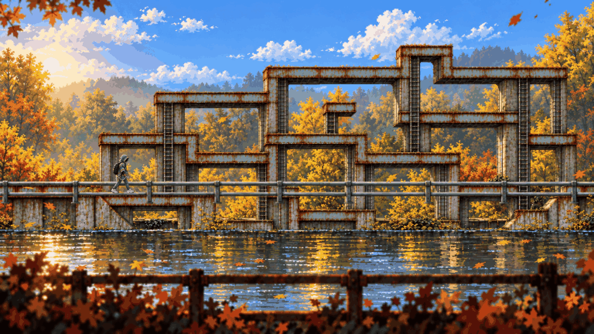

# DEGGSTER.EXE *(working title)*

**Poncho Goblins · DEGDEV 3 game jam · THD Deggendorf, 23–24 Oct 2026**



> A familiar campus. A plush mascot that wants you to keep fighting. A quantum experiment that broke the pond.

A 2D side-scrolling exploration-action game in hi-bit pixel art. You are a faceless THD student in a poncho. You follow Dexter, the university's panther plush, to the Hidden Garden pond, touch a reflection that is wrong, crash like a Windows app, and wake up in a version of campus where anomalies have taken over THD's autonomous machines. You fight them with a chair. Dexter keeps showing up to help, and keeps getting bigger, until he is the mascot. A secret horror game: cozy first, wrong on a second look.

## Start here

| | |
| --- | --- |
| 📖 **[Design documents](docs/README.md)** | Proposal → game design → story → levels → enemies → visuals → assets → stack → pipeline → jam plan → decisions → workflow |
| 🎨 **[Visual direction](art/direction/README.md)** | The look of every region, the cast, combat, HUD – one style |
| 🏞️ **[Stage concepts](art/locations/README.md)** | Every region clean and after its anomaly, explored up, down, left and right |
| 🧍 **[Sprite boards](art/sprites/README.md)** | Hero sheet (approved) and the sprite boards that follow |
| 🌉 **[Rusty Creek stage](art/stages/rusty-creek/README.md)** | The first level: 3 chunks × 7 layers, route graph |
| 🎙️ **[Meetings](docs/meetings/README.md)** | 13 transcribed recordings and what each one decided |
| 📍 **[Campus collages](references/campus/README.md)** · 🎮 **[Reference games](references/README.md)** | Our photos turned into location boards; the 18 games we learn from |

## Team

Vatsal (creative lead, gameplay) · Lex (level design) · Alexander (pipeline, art, build). How we work: [docs/12-TEAM-WORKFLOW.md](docs/12-TEAM-WORKFLOW.md). Agents: [AGENTS.md](AGENTS.md).

## Run things

```bash
python scripts/check_docs.py                     # links, images, no HTML, no duplicates
python scripts/creek_layers.py                   # verify the Rusty Creek layers
python scripts/navigation.py                     # refresh Previous / Next links
```

The game itself (Phaser 3 + TypeScript + Vite, deployed on Vercel) lands in `game/` – see [08 – Tech stack](docs/08-TECH-STACK.md).

[Rights and provenance](NOTICE.md) · [Contributing](CONTRIBUTING.md)
