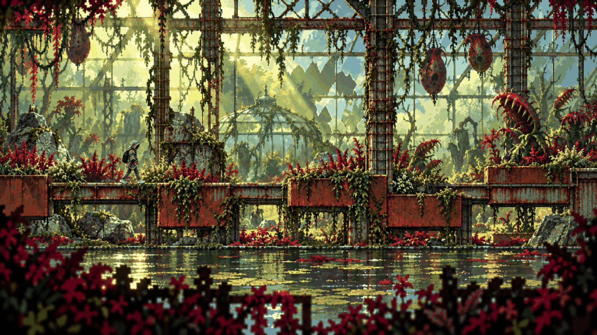

# Toxic Garden · the greenhouse

<!-- nav:start -->
[← Mensa · coffee machine save point](mensa-interior.md) · [Visual direction](README.md) · **6 / 14** · [Playground · the slide →](playground.md)
<!-- nav:end -->

**Review:** ✅ The palette shift works: acid green and magenta-red inside a ruined greenhouse, pods, a venus-flytrap mutant. It reads as more dangerous than Rusty Creek and still belongs to the same game.

## Brief

Match the first image's pixel style, but this region shifts the palette: sickly greens, magenta-red foliage, corten-steel rust planters and granite boulders from the collage, built into a ruined glass greenhouse structure like Dead Cells' arboretum - broken glass panes, iron ribs, vines, hanging pods. Mutated plants with mouths line the walls. The hero crosses a rusted planter ledge mid-screen; a long hanging vine is the only route up. Dangerous, lush, more uncanny than Rusty Creek.

## Inputs

- [style-master](style-master.md) (this pack)
- [toxic-garden.png](../../references/campus/images/toxic-garden.png)
- [arboretum-040.jpg](../../references/games/dead-cells/images/arboretum-040.jpg)
- `plant-dungeon-v0-zddbdviir6821.webp` (Downloads, outside Git)
- [hero-preview.png](../sprites/images/hero-preview.png)

Model `gpt-image-2.5-sunburst` · pixel factor 2 · source image `images/toxic-garden.png` · rebuild: `python scripts/make_boards.py draw --config art/direction/direction.json --redo toxic-garden`

<!-- nav:start -->
[← Mensa · coffee machine save point](mensa-interior.md) · [Visual direction](README.md) · **6 / 14** · [Playground · the slide →](playground.md)
<!-- nav:end -->
