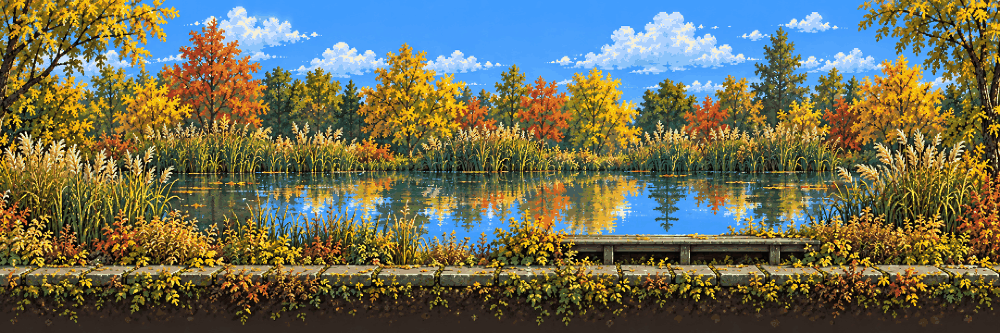
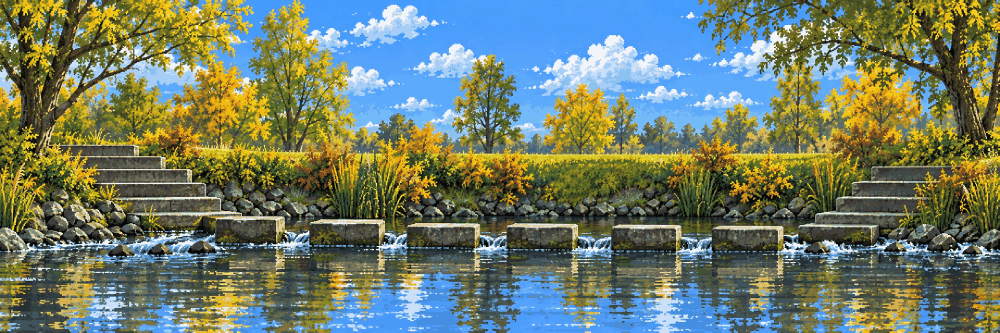
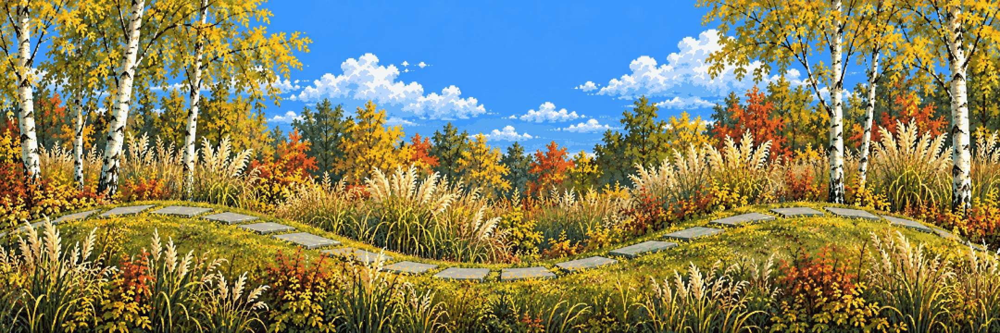
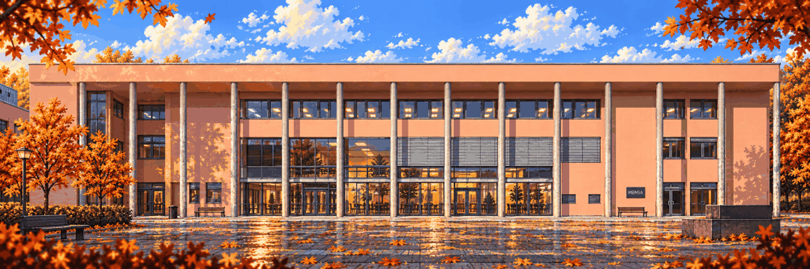
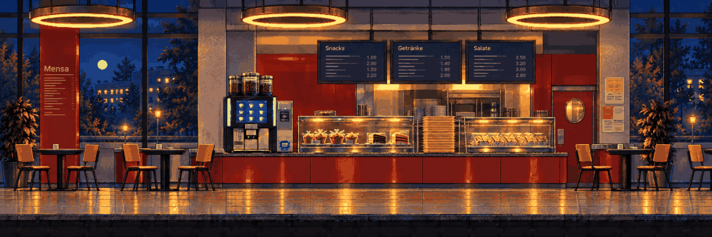
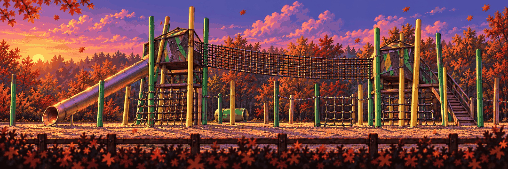

# Location strips

Every region as a horizontal side-scrolling background, 2160×720 – the same size as one Rusty Creek stage chunk – then **extended to the left and right** from its own edges to prove it keeps going. Each strip comes from its [campus collage](../../references/campus/README.md) plus its [visual-direction](../direction/README.md) image, drawn in the style master's look. No characters: these are backgrounds. Next step per region: split into the seven layers like [Rusty Creek](../stages/rusty-creek/README.md). Pipeline: [09 – Art pipeline](../../docs/09-ART-PIPELINE.md).

| | |
| --- | --- |
|  **[Hidden Garden · the pond](hidden-garden.md)** |  **[Stepping-stone creek](stepping-stones.md)** |
|  **[Lost in the Green](lost-in-the-green.md)** |  **[Campus · the Mensa facade](campus.md)** |
|  **[Mensa · inside at night](mensa.md)** |  **[Toxic Garden · the greenhouse](toxic-garden.md)** |
|  **[Playground · the slide](playground.md)** |  |
