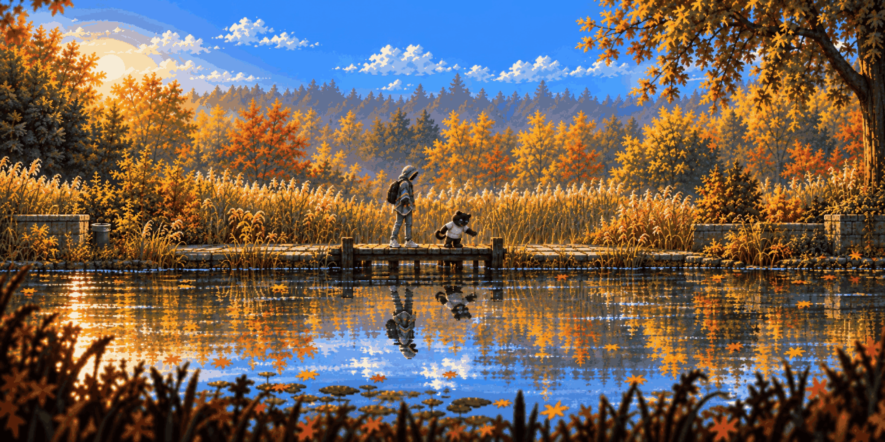
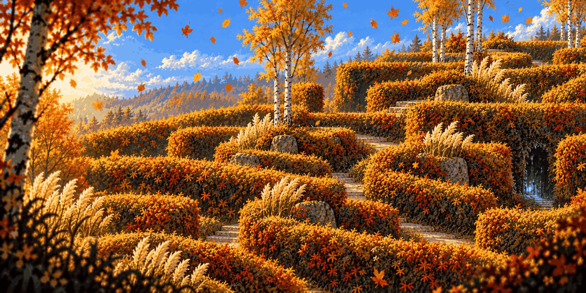
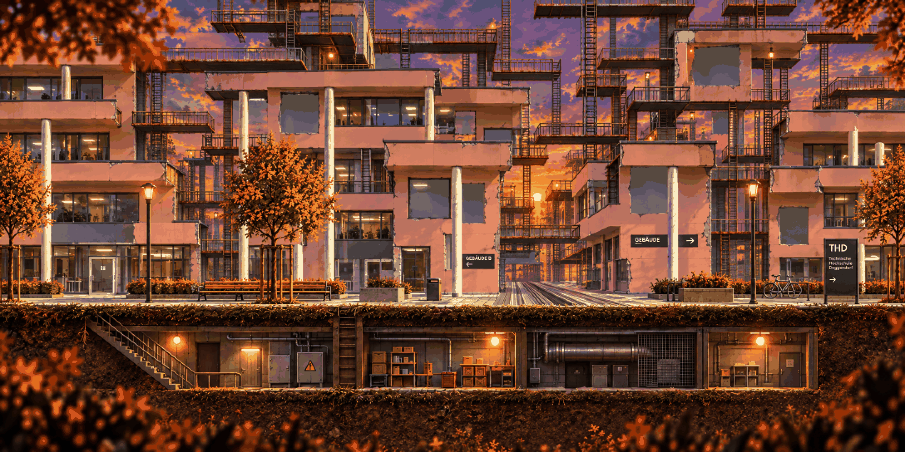
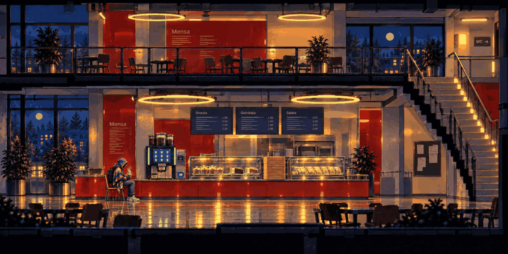
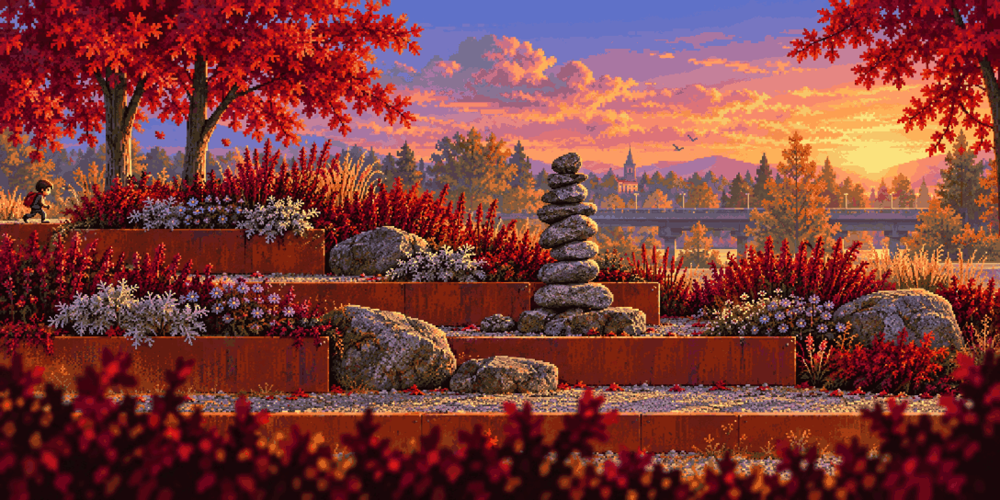
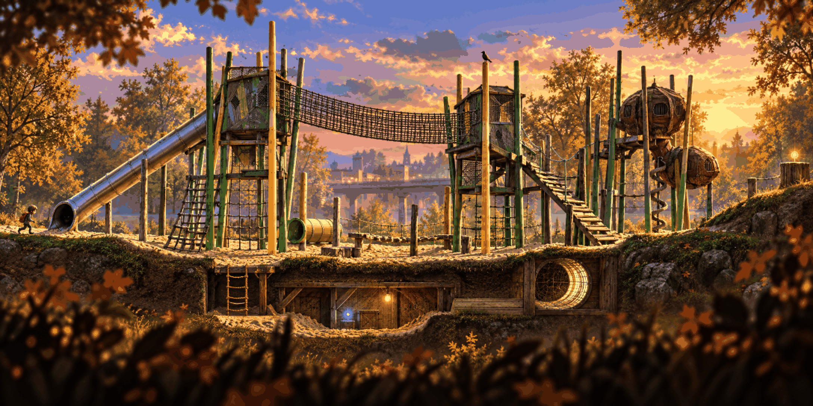

# Stage concepts

Every region in two states: **clean** – the real campus place, cozy and calm – and **anomaly** – the same place after you touch that region's anomaly, when the stage turns, pushes you back to its start and becomes the version you actually explore. [Rusty Creek](../stages/rusty-creek/README.md) already exists as a pair: the clean creek and bridge, then the rust maze. Each concept is 2176×1088 (2:1), so routes go up and down as well as left and right: hills, slopes to slide down, ledges to grab, vines and ladders to climb, an underground pocket. Foreground leaves and grass blur over the camera like Planet of Lana. The concepts become playable stages through the layer pipeline in [09 – Art pipeline](../../docs/09-ART-PIPELINE.md).

| | |
| --- | --- |
|  **[Hidden Garden · clean](hidden-garden-clean.md)** |  **[Hidden Garden · anomaly](hidden-garden-anomaly.md)** |
|  **[Lost in the Green · clean](lost-in-the-green-clean.md)** |  **[Lost in the Green · anomaly](lost-in-the-green-anomaly.md)** |
|  **[Campus · clean](campus-clean.md)** |  **[Campus · anomaly](campus-anomaly.md)** |
|  **[Mensa · clean](mensa-clean.md)** |  **[Mensa · anomaly](mensa-anomaly.md)** |
|  **[Toxic Garden · clean](toxic-garden-clean.md)** |  **[Toxic Garden · anomaly](toxic-garden-anomaly.md)** |
|  **[Playground · clean](playground-clean.md)** |  **[Playground · anomaly](playground-anomaly.md)** |
