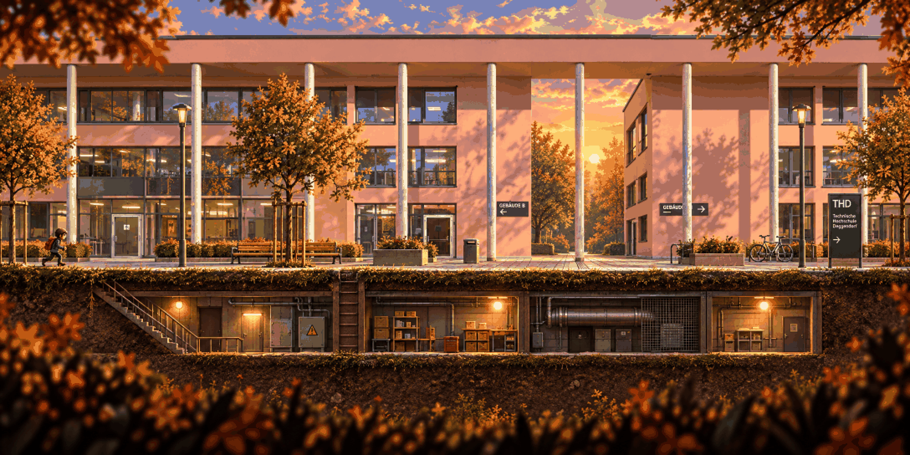

# Campus · clean

<!-- nav:start -->
[← Lost in the Green · anomaly](lost-in-the-green-anomaly.md) · [Stage concepts](README.md) · **5 / 12** · [Campus · anomaly →](campus-anomaly.md)
<!-- nav:end -->

**Review:** 🟡 Third take: a flat facade with an underground basement (stairs, ladder, corridors), the plaza and THD sign. Still no scaffold – the model drops it every time; add it as its own layer. (Takes 1–2: a printed title label, then a canal from the style master.)

## Brief

Same FORMAT, flatness, layering and pixel style as the FIRST image (a side-view stage with ground and an underground layer) - but a different place: THD's campus from the photos (images 2-4 are only material references). NO water, NO pond, NO canal. Composition left to right: a long salmon-pink building facade with white columns and glass ground floor, PARALLEL to the screen; in the middle a tall section wrapped from pavement to roof in construction SCAFFOLDING that fills a third of the image width: aluminium tubes, wide plank decks on four levels, zigzag ladders between them - empty, no people; a flat roof terrace at the top right; along the bottom a paved plaza with a bike rack, two young autumn trees and the yellow town-sign with a green assembly-point sign on a pole; BELOW the plaza, cut away like the first image's underground, a basement corridor with pipes reached by a stairwell on the left. Under the scaffold a small puddle of black fluid that reflects nothing - the region's anomaly. Golden late afternoon. No text.

## Inputs

- [playground-clean](playground-clean.md) (this pack)
- `20261022_142033.jpg` (GameJam_ References, outside Git)
- `20261022_141518.jpg` (GameJam_ References, outside Git)
- `20261023_131401.jpg` (GameJam_References-2, outside Git)

Model `gpt-image-2.5-sunburst` · pixel factor 2 · source image `images/campus-clean.png` · rebuild: `python scripts/make_boards.py draw --config art/locations/locations.json --redo campus-clean`

<!-- nav:start -->
[← Lost in the Green · anomaly](lost-in-the-green-anomaly.md) · [Stage concepts](README.md) · **5 / 12** · [Campus · anomaly →](campus-anomaly.md)
<!-- nav:end -->
