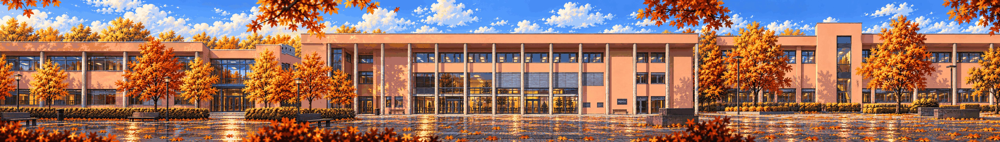

# Campus · the Mensa facade

<!-- nav:start -->
[← Lost in the Green](lost-in-the-green.md) · [Location strips](README.md) · **4 / 7** · [Mensa · inside at night →](mensa.md)
<!-- nav:end -->

**Extended left and right** from its own edges (the original strip is the middle, pixel-exact):

**Review:** 🟡 Flat pink-render campus with lit windows, a reflective plaza and autumn trees; the extension adds two more wings. Missing: the Mensa scaffolding and the yellow sign – add them as separate props/layers. The left join shows a hard building edge; hide it behind a tree layer.

## Brief

From the collage: modern campus buildings in pink render with long window bands and grey columns, seen exactly front-on as a flat facade; in the middle the Mensa facade under construction with scaffolding decks, ladders and planks that form climbable platforms; a paved plaza as the walkable ground with the yellow town-sign-style post and a green assembly-point sign, bike racks, a bin, young autumn trees. Dusk, warm lit windows. The subtle wrong detail: one window shows the room in daylight.

## Inputs

- [campus.png](../../references/campus/images/campus.png)
- [campus-mensa-preview.png](../direction/images/campus-mensa-preview.png)
- `20261023_131401.jpg` (GameJam_References-2, outside Git)
- [after-center.png](../stages/rusty-creek/images/after-center.png)
- [style-master-preview.png](../direction/images/style-master-preview.png)

Model `gpt-image-2.5-sunburst` · pixel factor 2 · source image `images/campus.png` · rebuild: `python scripts/make_boards.py draw --config art/locations/locations.json --redo campus`

<!-- nav:start -->
[← Lost in the Green](lost-in-the-green.md) · [Location strips](README.md) · **4 / 7** · [Mensa · inside at night →](mensa.md)
<!-- nav:end -->
