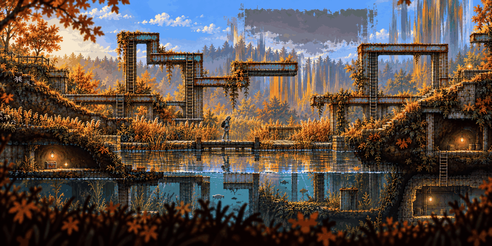

# Hidden Garden · anomaly

<!-- nav:start -->
[← Hidden Garden · clean](hidden-garden-clean.md) · [Location strips](README.md) · **2 / 12** · [Lost in the Green · clean →](lost-in-the-green-clean.md)
<!-- nav:end -->

**Review:** ✅ The strongest stage image so far: girders grown through the reeds, a grey 404 rectangle in the sky, stretched trees, lit caves and an underwater layer – routes in every direction.

## Brief

The SAME stage as the first image - same camera, same layout, same landmarks - a second after the hero touched the pond. The reflection has climbed out of the water: rusty blue-green girders from the second image grow up through the reeds and the deck, the hill path is cut and shifted sideways in places, a strip of trees is stretched into vertical streaks, a rectangle of sky has become flat grey with torn edges. Dexter is gone. Still beautiful, now wrong.

## Inputs

- [hidden-garden-clean](hidden-garden-clean.md) (this pack)
- [after-center.png](../stages/rusty-creek/images/after-center.png)
- [style-master-preview.png](../direction/images/style-master-preview.png)

Model `gpt-image-2.5-sunburst` · pixel factor 2 · source image `images/hidden-garden-anomaly.png` · rebuild: `python scripts/make_boards.py draw --config art/locations/locations.json --redo hidden-garden-anomaly`

<!-- nav:start -->
[← Hidden Garden · clean](hidden-garden-clean.md) · [Location strips](README.md) · **2 / 12** · [Lost in the Green · clean →](lost-in-the-green-clean.md)
<!-- nav:end -->
