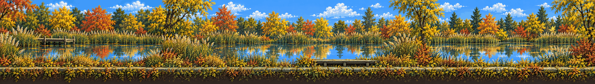

# Hidden Garden · the pond

<!-- nav:start -->
[← Location strips](README.md) · [Location strips](README.md) · **1 / 7** · [Stepping-stone creek →](stepping-stones.md)
<!-- nav:end -->

**Extended left and right** from its own edges (the original strip is the middle, pixel-exact):

**Review:** ✅ Second take: flat side view, the pond with mirrored autumn trees, the timber deck, a stone ledge as the continuous ground line. (First take copied the hero, Dexter and girders from its direction image – direction images are no longer inputs for strips.)

## Brief

Prologue region, drawn ONLY from the first image (the Hidden Garden collage): reed beds and ornamental grasses, a stone-slab path, a small timber deck along a still pond across the middle third with mirrored reflections, autumn trees behind. The second image is only an example of the strip FORMAT (flat side view, ground line leaving both edges) - do not copy its creek or stones. No buildings, no steel, no structures besides the deck. The subtle wrong detail: the pond's reflection shows one tree that isn't on the bank.

## Inputs

- [hidden-gardens.png](../../references/campus/images/hidden-gardens.png)
- [stepping-stones](stepping-stones.md) (this pack)
- [style-master-preview.png](../direction/images/style-master-preview.png)

Model `gpt-image-2.5-sunburst` · pixel factor 2 · source image `images/hidden-garden.png` · rebuild: `python scripts/make_boards.py draw --config art/locations/locations.json --redo hidden-garden`

<!-- nav:start -->
[← Location strips](README.md) · [Location strips](README.md) · **1 / 7** · [Stepping-stone creek →](stepping-stones.md)
<!-- nav:end -->
