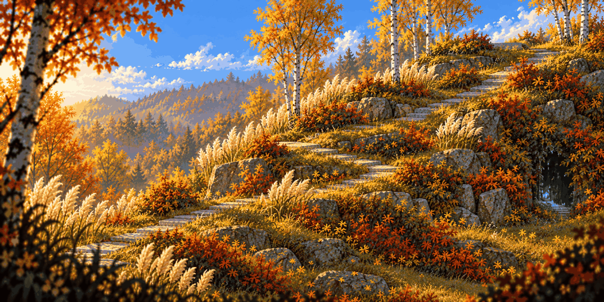

# Lost in the Green · clean

<!-- nav:start -->
[← Hidden Garden · anomaly](hidden-garden-anomaly.md) · [Stage concepts](README.md) · **3 / 12** · [Lost in the Green · anomaly →](lost-in-the-green-anomaly.md)
<!-- nav:end -->

**Review:** ✅ A real mountainside: the slab path climbs to the upper right, a branch dips to a hollow under the roots, rock ledges, pampas blurring the foreground.

## Brief

Built from the first image (approved: keep its pampas grass, birches, slab path and golden light) into a stage that climbs like a mountainside: the slab path winds up over soft grassy hills from bottom-left toward a high ridge at the top right; a second path splits off and dives down into a hollow under the roots of a big birch (an underground pocket); a steep grassy slope to slide down; tall grass screens you can walk behind. Near the ridge stands a tall grey Bayerwald granite boulder shaped like an obelisk (from the photo) with one face polished like a mirror - the region's anomaly. The hero small on the lower path. Blurred pampas plumes over the bottom corners.

## Inputs

- [lost-in-the-green-preview.png](../direction/images/lost-in-the-green-preview.png)
- `20261022_141709.jpg` (GameJam_ References, outside Git)
- `20261022_143200.jpg` (GameJam_ References, outside Git)
- [style-master-preview.png](../direction/images/style-master-preview.png)

Model `gpt-image-2.5-sunburst` · pixel factor 2 · source image `images/lost-in-the-green-clean.png` · rebuild: `python scripts/make_boards.py draw --config art/locations/locations.json --redo lost-in-the-green-clean`

<!-- nav:start -->
[← Hidden Garden · anomaly](hidden-garden-anomaly.md) · [Stage concepts](README.md) · **3 / 12** · [Lost in the Green · anomaly →](lost-in-the-green-anomaly.md)
<!-- nav:end -->
