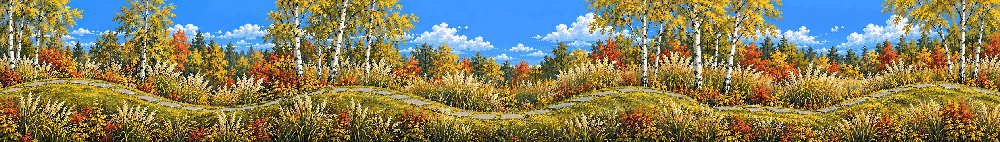

# Lost in the Green

<!-- nav:start -->
[← Stepping-stone creek](stepping-stones.md) · [Location strips](README.md) · **3 / 7** · [Campus · the Mensa facade →](campus.md)
<!-- nav:end -->

**Extended left and right** from its own edges (the original strip is the middle, pixel-exact):

**Review:** ✅ Fourth take: rolling hills with the slab path following the curves, pampas screens, birches, no water. Takes 1–3 copied the Rusty Creek maze, turned into a perspective creek, and then redrew the whole collage with labels; the fix was to use the raw photos (not the collage) with the Hidden Garden strip first as the format anchor.

## Brief

Make ONE single continuous image, the same FORMAT, flatness, pixel grain and light as the FIRST image (a flat side-view game background strip) - but a different place: the meadow from the photos (images 2-4 are perspective photos used only for materials). Tall cream pampas grass, ornamental grasses, white birches and autumn shrubs. A band of rolling grassy ground across the bottom third rises into two soft round hills and dips between them, with grey stone slabs laid along its surface following the curves. Layered screens of grass in front of and behind the ground line; birches and autumn trees behind. NO water, NO creek, NO panels, NO borders, NO labels, NO text, NO path receding into the distance. A dark gap in a hedge on the right hints at a secret path. The subtle wrong detail: one patch of grass bends against the wind.

## Inputs

- [hidden-garden](hidden-garden.md) (this pack)
- `20261022_141709.jpg` (GameJam_ References, outside Git)
- `20261022_141701.jpg` (GameJam_ References, outside Git)
- `20261022_142002.jpg` (GameJam_ References, outside Git)

Model `gpt-image-2.5-sunburst` · pixel factor 2 · source image `images/lost-in-the-green.png` · rebuild: `python scripts/make_boards.py draw --config art/locations/locations.json --redo lost-in-the-green`

<!-- nav:start -->
[← Stepping-stone creek](stepping-stones.md) · [Location strips](README.md) · **3 / 7** · [Campus · the Mensa facade →](campus.md)
<!-- nav:end -->
