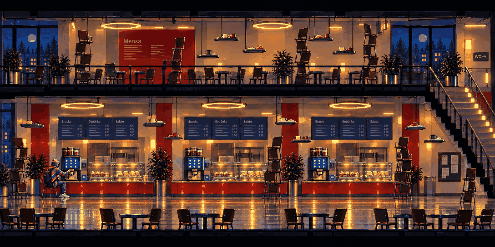

# Mensa · anomaly

<!-- nav:start -->
[← Mensa · clean](mensa-clean.md) · [Location strips](README.md) · **8 / 12** · [Toxic Garden · clean →](toxic-garden-clean.md)
<!-- nav:end -->

**Review:** ✅ The counter repeats three times, chairs stack into towers, trays float as steps – the clean layout, quietly wrong.

## Brief

The SAME stage as the first image after the hero touched the coffee machine screen: the hall stretches too long, chairs are stacked into wobbling towers that become platforms, trays hang in the air like steps, the counter repeats three times, every chair faces the coffee machine, the windows show the same moon twice. Same camera and landmarks, quietly wrong.

## Inputs

- [mensa-clean](mensa-clean.md) (this pack)
- [style-master-preview.png](../direction/images/style-master-preview.png)

Model `gpt-image-2.5-sunburst` · pixel factor 2 · source image `images/mensa-anomaly.png` · rebuild: `python scripts/make_boards.py draw --config art/locations/locations.json --redo mensa-anomaly`

<!-- nav:start -->
[← Mensa · clean](mensa-clean.md) · [Location strips](README.md) · **8 / 12** · [Toxic Garden · clean →](toxic-garden-clean.md)
<!-- nav:end -->
