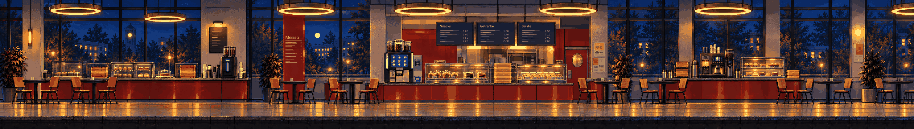

# Mensa · inside at night

<!-- nav:start -->
[← Campus · the Mensa facade](campus.md) · [Location strips](README.md) · **5 / 7** · [Toxic Garden · the greenhouse →](toxic-garden.md)
<!-- nav:end -->

**Extended left and right** from its own edges (the original strip is the middle, pixel-exact):

**Review:** ✅ A dollhouse cross-section at night: red counters, display cases, the glowing coffee machine, chairs, big windows; the extension continues the hall naturally. Menu boards carry text – replace with real game text later.

## Brief

Interior cross-section of the university cafeteria at night, seen exactly from the side like a dollhouse cut: glossy red counter fronts with speckled granite tops, glass display cases with cling-filmed muffins and cake, tall stacks of yellow trays, the black-and-steel self-service coffee machine glowing (save point), tables and plywood stacking chairs, big windows to the dark campus at the back. Warm pools of light, deep blue shadow elsewhere. The subtle wrong detail: every chair faces the coffee machine.

## Inputs

- `20261023_125138.jpg` (GameJam_References-2, outside Git)
- `20261023_125150.jpg` (GameJam_References-2, outside Git)
- `20261023_130817.jpg` (GameJam_References-2, outside Git)
- `20261023_124941.jpg` (GameJam_References-2, outside Git)
- [mensa-interior-preview.png](../direction/images/mensa-interior-preview.png)
- [style-master-preview.png](../direction/images/style-master-preview.png)

Model `gpt-image-2.5-sunburst` · pixel factor 2 · source image `images/mensa.png` · rebuild: `python scripts/make_boards.py draw --config art/locations/locations.json --redo mensa`

<!-- nav:start -->
[← Campus · the Mensa facade](campus.md) · [Location strips](README.md) · **5 / 7** · [Toxic Garden · the greenhouse →](toxic-garden.md)
<!-- nav:end -->
