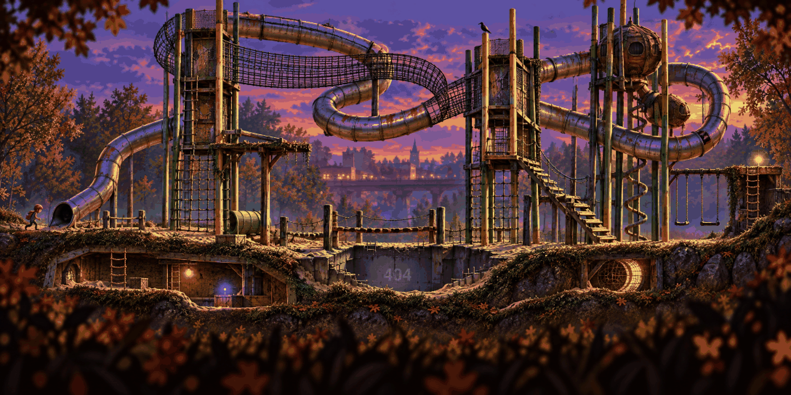

# Playground · anomaly

<!-- nav:start -->
[← Playground · clean](playground-clean.md) · [Stage concepts](README.md) · **12 / 12** · [Stage concepts →](README.md)
<!-- nav:end -->

**Review:** ✅ The slide coils across the stage, the towers stretch, the sand pit is a 404 hole; the den below stays as the lower route.

## Brief

The SAME stage as the first image after the hero slid into the dark slide: the towers have stretched far too tall, the net bridge loops back into itself, the tube slide coils across the whole frame as a passage you can walk inside, swings hang perfectly still, the sand pit is a flat grey 404 hole with torn edges. Purple dusk. Same camera and landmarks, quietly wrong, no gore.

## Inputs

- [playground-clean](playground-clean.md) (this pack)
- [style-master-preview.png](../direction/images/style-master-preview.png)

Model `gpt-image-2.5-sunburst` · pixel factor 2 · source image `images/playground-anomaly.png` · rebuild: `python scripts/make_boards.py draw --config art/locations/locations.json --redo playground-anomaly`

<!-- nav:start -->
[← Playground · clean](playground-clean.md) · [Stage concepts](README.md) · **12 / 12** · [Stage concepts →](README.md)
<!-- nav:end -->
