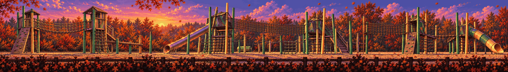

# Playground · the slide

<!-- nav:start -->
[← Toxic Garden · the greenhouse](toxic-garden.md) · [Location strips](README.md) · **7 / 7** · [Location strips →](README.md)
<!-- nav:end -->

**Extended left and right** from its own edges (the original strip is the middle, pixel-exact):

**Review:** ✅ Leaning green and yellow poles, net bridges, towers, slides, purple dusk; the extension adds two more towers and a second slide – exactly the 'keeps going' we want.

## Brief

From the collage: the adventure playground - leaning green and yellow timber poles, a rope-net bridge between timber towers, a timber climbing house, a tube slide, a sand ground, seen strictly from the side at dusk. Platforms on the towers and the net bridge are climbable. The subtle wrong detail: the slide's exit is far too dark.

## Inputs

- [playground.png](../../references/campus/images/playground.png)
- [playground-preview.png](../direction/images/playground-preview.png)
- [frame-020.jpg](../../references/animation/playground/images/frame-020.jpg)
- [style-master-preview.png](../direction/images/style-master-preview.png)

Model `gpt-image-2.5-sunburst` · pixel factor 2 · source image `images/playground.png` · rebuild: `python scripts/make_boards.py draw --config art/locations/locations.json --redo playground`

<!-- nav:start -->
[← Toxic Garden · the greenhouse](toxic-garden.md) · [Location strips](README.md) · **7 / 7** · [Location strips →](README.md)
<!-- nav:end -->
