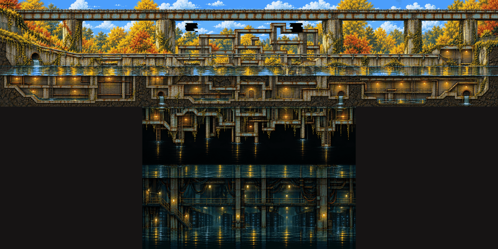
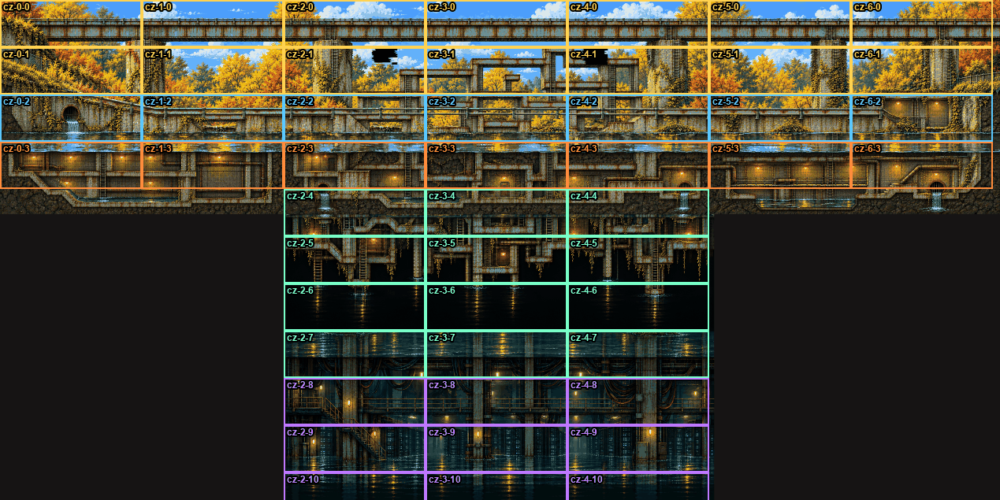

# Rusty Creek · stacked zone

The new world-art direction applied to Region 1: one zone as a **stacked cross-section** – the rails and steel bridges you climb, the creek path at water level, the creek, and under it the **built** underground of the campus (no natural caves: the anomaly overlaps the campus with itself, so everything below is culverts, drains, service rooms and the experiment's own spaces). It follows `zone-a` (Alexander's "perfect" direction: girder structure over the water, lit flooded rooms under it) with his correction that the underground must be lore, not caves.

Concept study, not yet playable art. Inputs, prompts and every take: [rusty-creek-stacked.json](rusty-creek-stacked.json). Scripts: `scripts/zones/creek_*.py` (outputs go to `tmp/zones/creek/`, gitignored). 16 image calls in total.

## The images

| Image | What it is |
| --- | --- |
| [zone.png](rusty-creek-stacked/zone.png) | **Anomaly zone overview**: centre + left + right + two below, 5078×2540 at concept size (shown crushed to half). Neighbours overlap by a third of a concept, so the grid step is 1451 px across and 726 px down |
| [clean.png](rusty-creek-stacked/clean.png) ([preview](rusty-creek-stacked/clean-preview.png)) | **Clean centre** (`clean-4`): the real creek. The rail bridge on two ivy piers, the cement creek path with benches and steps, campus buildings behind, the calm creek; under it a culvert shaft with a ladder dropping into an arched concrete storm drain lit by bulkhead lamps, ending in a round outfall |
| [anomaly.png](rusty-creek-stacked/anomaly.png) ([preview](rusty-creek-stacked/anomaly-preview.png)) | **Anomaly centre** (`anomaly-3b`): the same camera after Jenny's crash. The rust maze has grown between the piers and down through the creek bed into the built rooms – girders and ladders through tiled service rooms, doors, pipes, two outfalls; two 404 tears in the sky |
| [left.png](rusty-creek-stacked/left.png) | Left neighbour: the bridge ends on an abutment in a soft grassy embankment with a fence, a culvert mouth in the wall above the water, a two-storey row of service rooms under the creek |
| [right.png](rusty-creek-stacked/right.png) | Right neighbour: the path climbs stairs to a lit service building set into the bank; under the creek a tall pump hall with a catwalk and a sump, two outfalls |
| [down.png](rusty-creek-stacked/down.png) | First level down: the **wrong reflection**. A tall flooded hall whose ceiling is the rooms above; from it the girder maze hangs **upside down**, its ladders and tips dipping into still black water |
| [down2.png](rusty-creek-stacked/down2.png) | Second level down: the experiment's **cable vault and server room**, knee-deep in water, racks with small blue lights, cables hanging like roots, a catwalk and stairs |
| [grid.png](rusty-creek-stacked/grid.png) | The proposed chunk grid drawn over the overview (below) |

## What worked

- **Layout through the edited image, look through the references – but only references that don't carry a competing layout.** `clean-3` (my flat guide as the edited image, `before-center.png` + `zone-a.png` as references) kept the real bridge, piers and creek, then copied zone-a's caves under the water.
- **Underground by a masked edit with the top as known pixels.** `clean-4`/`clean-5` keep `clean-3`'s top pixel-exact (mask transparent only below y 730, feathered paste back) and repaint the underground from a prompt that names built spaces and forbids caves, stalactites, mine timbers and jetties. Both gave concrete storm drains instead of caves. `clean-4` (guide's rough rooms pasted in as the base) has a ladder shaft and more variety than `clean-5` (no guide).
- **Anomaly from the clean image.** The clean concept as the edited image plus `after-center.png` as the only look reference (`anomaly-3`) kept the bridge, piers, path and the water line, and grew the maze into the underground on its own – girders through tiled rooms, doors and pipes – which is exactly the lore.
- **404 tears as a masked patch** (`anomaly-3b`): two transparent rectangles in the sky, everything else exact. Clean black cuts with stair-stepped, streaked edges, no letters.
- **The wrong reflection as a masked patch on the grown neighbour** (`an-down-b`): the band-grown hall came out empty; repainting only the hall (y 370–960) with "the maze hangs upside down from the ceiling" gave the strongest image of the set.
- **Neighbours from a third of the edge as known pixels** (as `make_boards.py neighbour`), plus a 64 px ramp on the band's inner edge in the pasted-back band. Stitched with later parts on top, the seams don't show: girders, rail deck, railing, water line and the soil continue across.

## What failed

- **zone-a as a reference = zone-a's layout.** Every take that saw it (`clean-1`, `clean-2`, `anomaly-2`) drew its girder maze above the water (even for the *clean* state) and its natural caves with stalactites, jetties and waterfalls below. Never give it a whole concept.
- **The style master brings its hooded walker along** (`clean-1`, `clean-2`) despite "no people".
- **`after-center.png` alone with a long anomaly brief** (`anomaly-4`) dropped the whole underground and repainted after-center at game scale. The single strong reference wins over the edited image.
- **No take drew the 404 holes or the wrong reflection from the prompt alone** – both needed a masked patch.
- **Band-grown neighbours drift back toward clean.** Neither `an-right` nor its retry `an-right2` drew the asked-for open girder floor for the Jenny fight; with only the band as context, the maze thins out away from the seam. The boss clearing still has to be placed.
- **Scale.** Asked for a 27 px person (zone-a's overview scale), the model draws doors, railings and lamps at about game scale (a door ≈ 75 px, so a person ≈ 70 px). Read at that scale the underground rooms are 2.5–3 hero heights – too cramped. The grid below therefore reads the concepts as **layout at 1/3 scale** (hero 27 px), where rooms are 8–22 hero heights; the props get redrawn at the right size when chunks are painted.
- `an-down-b`'s hall has two water levels (the black mirror under the girder tips and the original teal floor below y 960) – reads as a step in the water; fix when the chunk is painted.

## Proposed chunk grid

At hero 27 px a 2160×720 game chunk (27 × 9 hero heights) is **720×240 px of concept**, so the stitched zone is a 7 × 11 grid (`cz-x-y`, x right, y down, `cz-0-0` top left). Only 49 cells are used.

| Rows | Columns | Space | Height in heroes | Route |
| --- | --- | --- | --- | --- |
| 0 | 0–6 | Rail bridge deck, sky, 404 tears | 9 (deck walk + air) | **High route**: up pier ladders onto the maintenance walk, the whole zone width; lookout dead ends over the trees |
| 1 | 0–6 | Girder maze between the piers (2–4), pier ladders, embankment (0) | 9 | Climb: maze decks and ladders (Jenny-slice "branches") – the centre's beat |
| 2 | 0–6 | **Creek path** and water line, culvert mouth (0), stairs to the service building (6) | 9 | **Main route**, left to right; entry from the embankment (0), boss clearing to be placed on 5–6 |
| 3 | 0–6 | Built underground under the creek: service rooms (0–1), the maze through tiled rooms (2–4), pump hall (5–6) | 8.5 (rooms) | **Low route**: in through the culvert (0) or the ladder shaft (2), out through the pump hall's stairs (6) – reconnects with the path |
| 4 | 2–4 | Outfalls and the creek-bed slab, ladder shafts down | 9 | Transition chunk (surface stack → reflection stack) |
| 5–7 | 2–4 | **The wrong reflection**: the upside-down maze over still water | 22 (hall) | Optional descent: climb *down* the inverted ladders, walk the hanging decks; secret: the maze above, mirrored |
| 8–10 | 2–4 | The experiment's server vault, knee-deep | 20 | Deepest dead end: lore (the experiment's machines still humming), a pickup, the return ladder |

For the 8–12-minute slice ([#157](../../docs/04-WORLD-AND-LEVELS.md#rebuild-plan-157)) rows 1–3 × columns 0–6 (21 chunks) are already more than enough; rows 4–10 are the hook for later regions or a post-slice secret. Clean state: rows 0–3 only (the reflection does not exist yet); only the structure layers change, as in the current Rusty Creek.

## Next

- Clean neighbours (left, right) grown from `clean.png` the same way, so both states share the layout.
- Place the Jenny clearing (an open girder floor on `cz-5-2`/`cz-6-2`) by a masked patch, not by a brief.
- Redraw at chunk scale through the layer pipeline ([09](../../docs/09-ART-PIPELINE.md)), with Lex's route deciding which of the 49 cells exist.
