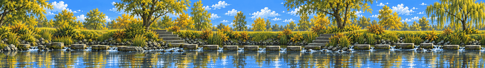

# Stepping-stone creek

<!-- nav:start -->
[← Hidden Garden · the pond](hidden-garden.md) · [Location strips](README.md) · **2 / 7** · [Lost in the Green →](lost-in-the-green.md)
<!-- nav:end -->

**Extended left and right** from its own edges (the original strip is the middle, pixel-exact):

**Review:** ✅ The model strip: flat side elevation, stepping stones as a row of low platforms at different heights, clean reflections, ground leaving both edges. It is the format example for the others. Extension repeats the stone staircase once – acceptable, vary it when cutting layers.

## Brief

Connector region along the creek. From the collage: large flat granite stepping stones and stone steps crossing a shallow, clear creek with gentle ripples, reeds and willows, a grassy bank that rises and dips in broad soft curves. Seen strictly from the side, the stones form a row of low platforms at slightly different heights. The subtle wrong detail: one stone's reflection is missing.

## Inputs

- [creek-stones-v3.png](../../references/campus/images/creek-stones-v3.png)
- [before-center.png](../stages/rusty-creek/images/before-center.png)
- [style-master-preview.png](../direction/images/style-master-preview.png)

Model `gpt-image-2.5-sunburst` · pixel factor 2 · source image `images/stepping-stones.png` · rebuild: `python scripts/make_boards.py draw --config art/locations/locations.json --redo stepping-stones`

<!-- nav:start -->
[← Hidden Garden · the pond](hidden-garden.md) · [Location strips](README.md) · **2 / 7** · [Lost in the Green →](lost-in-the-green.md)
<!-- nav:end -->
