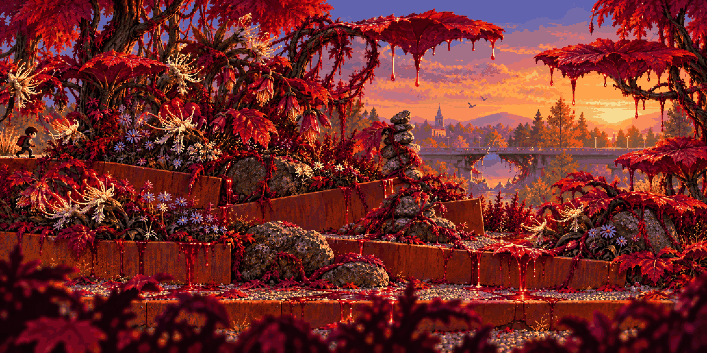

# Toxic Garden · anomaly

<!-- nav:start -->
[← Toxic Garden · clean](toxic-garden-clean.md) · [Stage concepts](README.md) · **10 / 12** · [Playground · clean →](playground-clean.md)
<!-- nav:end -->

**Review:** ✅ Third take: crimson leaves as big as umbrellas form platforms, corten beds tilt, the background bridge has a hole, only amber droplets. (Take 2 dripped red sap that read as blood – rejected for no-gore.) A small stray figure on the left isn't our hero; it goes when the chunk is layered.

## Brief

The SAME stage as the first image after the hero touched the turned flower: the crimson plantings have grown huge and leaning, leaves as big as umbrellas form bouncy platforms, corten beds tilt at odd angles, every flower now faces the hero's position, a faint shimmer hangs over the gravel, the bridge in the background has a flat grey 404 hole with torn edges. NO red liquid, NO dripping, NO blood, NO sap streams - if anything leaks it is a thin clear amber resin. Same camera and landmarks; lush, beautiful and only quietly wrong.

## Inputs

- [toxic-garden-clean](toxic-garden-clean.md) (this pack)
- [style-master-preview.png](../direction/images/style-master-preview.png)

Model `gpt-image-2.5-sunburst` · pixel factor 2 · source image `images/toxic-garden-anomaly.png` · rebuild: `python scripts/make_boards.py draw --config art/locations/locations.json --redo toxic-garden-anomaly`

<!-- nav:start -->
[← Toxic Garden · clean](toxic-garden-clean.md) · [Stage concepts](README.md) · **10 / 12** · [Playground · clean →](playground-clean.md)
<!-- nav:end -->
