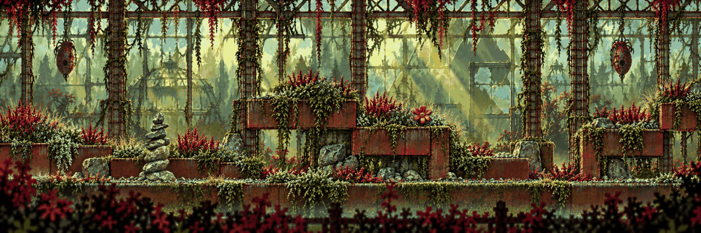
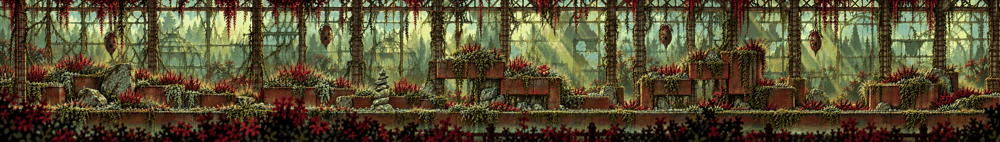

# Toxic Garden · the greenhouse

<!-- nav:start -->
[← Mensa · inside at night](mensa.md) · [Location strips](README.md) · **6 / 7** · [Playground · the slide →](playground.md)
<!-- nav:end -->

**Extended left and right** from its own edges (the original strip is the middle, pixel-exact):

**Review:** ✅ Ruined greenhouse ribs, corten planters as stepped platforms, hanging pods, red and purple plantings; the extension keeps the rhythm without copying.

## Brief

From the collage: corten-steel rust planters, granite boulders and gravel beds with red and purple autumn plantings, built into the skeleton of a ruined glass greenhouse (iron ribs, broken panes) like Dead Cells' arboretum. Sickly green and magenta-red palette, hanging pods, vines that can be climbed. Planters form stepped platforms. The subtle wrong detail: one of the flowers is turned toward the viewer.

## Inputs

- [toxic-garden.png](../../references/campus/images/toxic-garden.png)
- [toxic-garden-preview.png](../direction/images/toxic-garden-preview.png)
- [arboretum-040.jpg](../../references/games/dead-cells/images/arboretum-040.jpg)
- [style-master-preview.png](../direction/images/style-master-preview.png)

Model `gpt-image-2.5-sunburst` · pixel factor 2 · source image `images/toxic-garden.png` · rebuild: `python scripts/make_boards.py draw --config art/locations/locations.json --redo toxic-garden`

<!-- nav:start -->
[← Mensa · inside at night](mensa.md) · [Location strips](README.md) · **6 / 7** · [Playground · the slide →](playground.md)
<!-- nav:end -->
