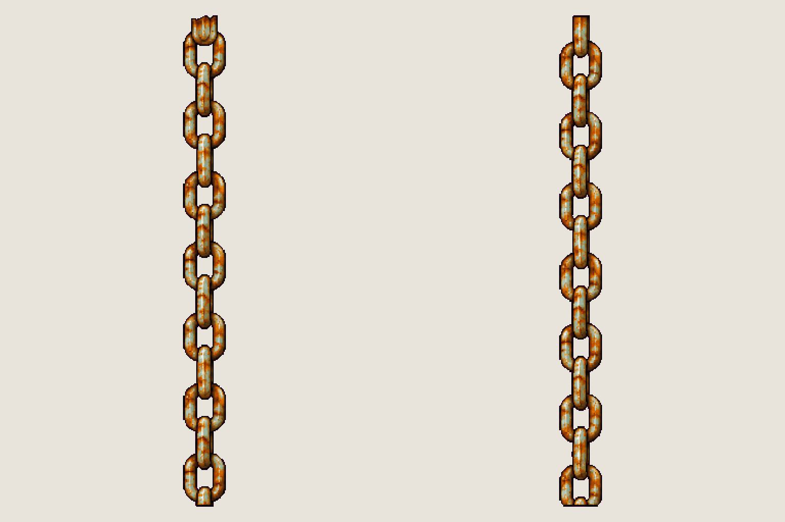

# Prop · the platforms' chains

<!-- nav:start -->
[← Prop · Jenny's arena platforms](arena-platform.md) · [Sprite boards](README.md) · **31 / 32** · [Prop · Jenny's arena wall →](arena-wall.md)
<!-- nav:end -->

**Review:** 🟨 Awaiting Alexander's review (25 Oct). The platforms hang from the girder over the arena: scripts/arena_platforms.py tiles this chain's link period from each platform end up to the girder's underside. The second frame came out as a second chain instead of an eye-bolt, so it is unused.

## Brief

On a flat, solid, pure magenta #FF00FF background (no paper colour, no ground shadows), with NO text at all - no titles, no captions, no labels: Image 1 is an approved prop from this game, a rusty steel girder platform: draw in exactly its pixel-art look, pixel grain, palette and rusty orange-on-steel colours. Prop sprite sheet, 1 row, exactly 2 frames, side by side with a wide magenta gap: frame 1, ONE heavy rusted steel CHAIN hanging perfectly straight and vertical, about as long as the platform in image 1 is wide, made of many identical oval links alternating face-on and edge-on, the top and bottom links cut flat; frame 2, ONE heavy steel EYE-BOLT anchor: a small rusted base plate with two rivets and a thick eye ring on top, with a single rusted shackle through the ring - the piece that would sit on top of the platform where the chain is fixed. Both frames at the SAME pixel scale (the chain's links as thick as the shackle). No platform, no people, no scenery.

## Inputs

- [arena-platform-preview.png](images/arena-platform-preview.png)
- [coffee-machine-preview.png](images/coffee-machine-preview.png)
- [style-master-preview.png](../direction/images/style-master-preview.png)

Model `gpt-image-2.5-sunburst` · pixel factor 2 · source image `images/arena-chain.png` · rebuild: `python scripts/make_boards.py draw arena-chain --redo --config art/sprites/boards.json`

<!-- nav:start -->
[← Prop · Jenny's arena platforms](arena-platform.md) · [Sprite boards](README.md) · **31 / 32** · [Prop · Jenny's arena wall →](arena-wall.md)
<!-- nav:end -->
