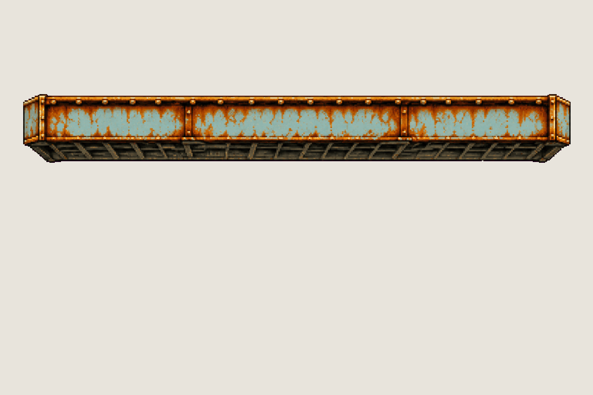

# Prop · Jenny's arena platforms

<!-- nav:start -->
[← Secret · the rubber chicken](rubber-chicken.md) · [Sprite boards](README.md) · **30 / 32** · [Prop · the platforms' chains →](arena-chain.md)
<!-- nav:end -->

**Review:** 🟨 Awaiting Alexander's review (25 Oct). Replaces the strip cut from the maze plate, which read flat and floated with no reason (Alexander). Drawn with volume from the coffee-machine sheet's look and the maze's own girder as the material reference: a riveted box girder with a grated underside, 202 × 25 px in the game. The prompt asked for eye-bolts and chain stubs, and the model drew the platform alone, so it is locked and the chains are their own board.

## Brief

On a flat, solid, pure magenta #FF00FF background (no paper colour, no ground shadows, no dust under the objects), with NO text at all - no titles, no captions, no frame numbers, no labels, no readable words or logos: Image 1 is an approved prop sheet from this game: draw in exactly that pixel-art look - solid three-dimensional objects drawn as detailed 2D pixel art with volume, the same pixel grain, palette and warm rim light. Image 2 shows the rusty steel girders of the level these props hang in: copy their material exactly - pale blue-grey painted steel eaten by orange rust, riveted flanges, a dark grated underside. Prop sprite sheet, 2 rows. Row 1, exactly 1 frame: ONE short girder PLATFORM segment hung like a stage rigging bar, seen from slightly below like image 2: a long flat box beam about FIVE times as long as it is tall, its front face with rivets, a lit top flange, a dark grated underside with depth, solid end caps showing its thickness; on top, near each end, a heavy steel eye-bolt with the lowest three links of a rusted chain rising straight up from it. Row 2, exactly 1 frame: ONE long straight vertical rusted steel CHAIN hanging perfectly straight up and down, many identical links, about as long as the platform in row 1, the same chain as on the platform. Both rows at the SAME pixel scale. Rows separated by a wide empty magenta band. No people, no scenery, no sky.

## Inputs

- [coffee-machine-preview.png](images/coffee-machine-preview.png)
- [girder-reference.png](../stages/rusty-creek/prototype/girder-reference.png)
- [style-master-preview.png](../direction/images/style-master-preview.png)

Model `gpt-image-2.5-sunburst` · pixel factor 2 · source image `images/arena-platform.png` · rebuild: `python scripts/make_boards.py draw arena-platform --redo --config art/sprites/boards.json`

<!-- nav:start -->
[← Secret · the rubber chicken](rubber-chicken.md) · [Sprite boards](README.md) · **30 / 32** · [Prop · the platforms' chains →](arena-chain.md)
<!-- nav:end -->
