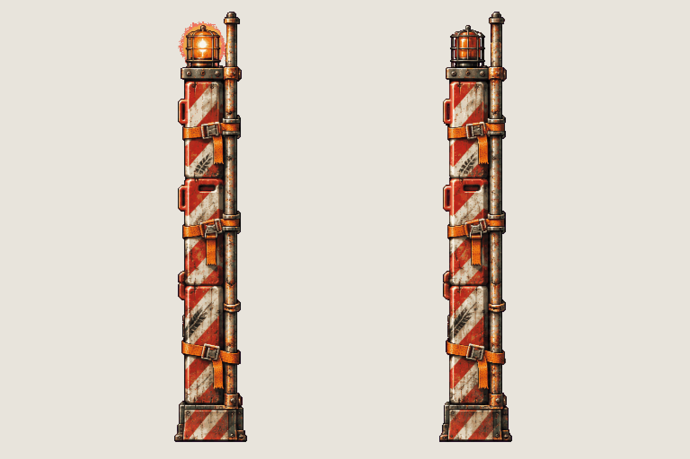

# Prop · Jenny's arena wall

<!-- nav:start -->
[← Prop · the platforms' chains](arena-chain.md) · [Sprite boards](README.md) · **32 / 32** · [Sprite boards →](README.md)
<!-- nav:end -->

**Review:** 🟨 Awaiting Alexander's review (25 Oct). Playtest J7: the arena's walls were code-drawn rectangles with hazard stripes. First draw: a barrier column of red-and-white crowd-control panels strapped to a rusted pole, with a caged warning lamp (lit, dark). 300 px tall in the game, as tall as the walls. The lamp's halo specks are dropped by "despeckle".

## Brief

On a flat, solid, pure magenta #FF00FF background (no paper colour, no ground shadows, no dust under the objects), with NO text at all - no titles, no captions, no frame numbers, no labels, no readable words or logos: Image 1 is an approved prop sheet from this game: draw this sheet in exactly that pixel-art look - the same pixel grain, palette and warm rim light. Prop sprite sheet of ONE tall narrow BARRIER COLUMN that closes a race-track arena on a rusty steel girder maze: a stack of old red-and-white striped plastic and steel crowd-control barrier panels and a rusted scaffold pole, lashed together with orange ratchet straps, standing straight up, about TEN times as tall as it is wide, its top crowned by a small amber rotating warning lamp in a cage (like the race car from image 2 might have hit it before: a few dents, black tyre marks). Strict front view, the same in every frame. 1 row, exactly 2 frames: frame 1 the warning lamp lit bright amber with a glow, frame 2 the same column with the lamp dark. Both frames identical apart from the lamp, same scale, standing on the SAME invisible ground line, with a wide clear magenta gap between them. Count the frames: the row has EXACTLY 2. No people, no car, no scenery, no ground.

## Inputs

- [coffee-machine-preview.png](images/coffee-machine-preview.png)
- [boss-jenny-preview.png](images/boss-jenny-preview.png)
- [style-master-preview.png](../direction/images/style-master-preview.png)

Model `gpt-image-2.5-sunburst` · pixel factor 2 · source image `images/arena-wall.png` · rebuild: `python scripts/make_boards.py draw arena-wall --redo --config art/sprites/boards.json`

<!-- nav:start -->
[← Prop · the platforms' chains](arena-chain.md) · [Sprite boards](README.md) · **32 / 32** · [Sprite boards →](README.md)
<!-- nav:end -->
