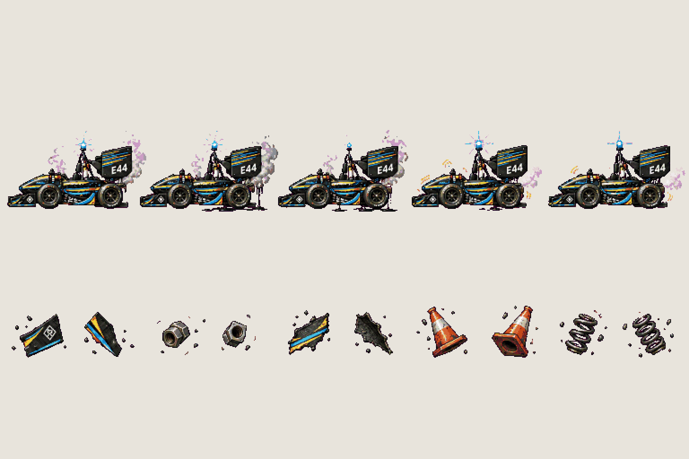
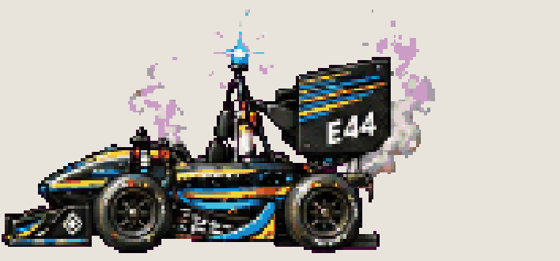
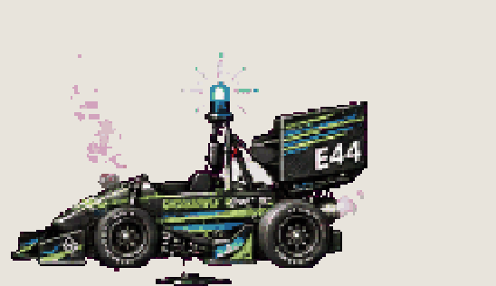
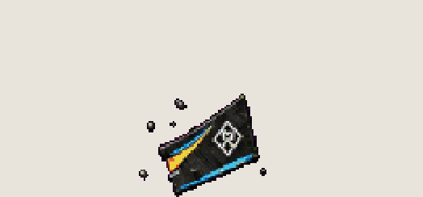
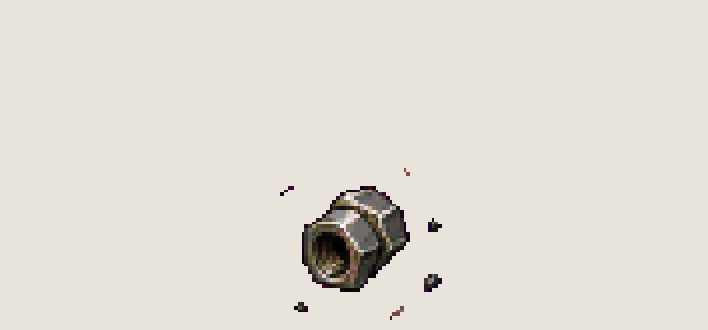
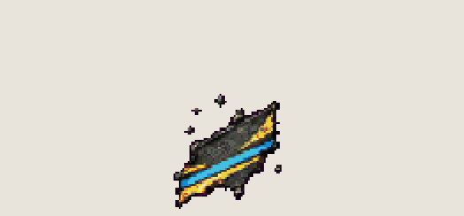
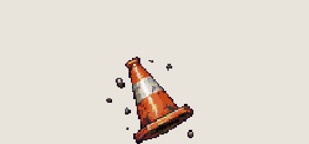
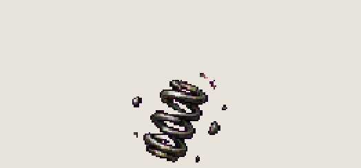

# Boss · Jenny, stunned and debris

<!-- nav:start -->
[← Boss · Jenny, attacks](boss-jenny.md) · [Sprite boards](README.md) · **16 / 18** · [Dexter · moves →](dexter.md)
<!-- nav:end -->

**Review:** ✅ Approved 24 Oct by Alexander. 270 px long like the approved direction (docs/04), one livery in both sheets; exported to game/public/assets/sprites/ with export_atlas.py. The looping previews below are at twice game size.

## In motion

At twice game size, 12 fps unless the atlas says otherwise: stunned, reboot, debris-1, debris-2, debris-3, debris-4, debris-5.

      

## Brief

On a flat, solid, pure magenta #FF00FF background (no paper colour, no ground shadows, no dust under the feet), with NO text at all - no titles, no captions, no frame numbers, no labels under the figures: JENNY, exactly the SAME car as in the first image (her approved attack frames) and the second image (the approved direction): an open-wheel Formula Student single-seater in carbon black with thin GOLD and BLUE stripes (no green), E44 on the big rear wing, the same rear wing height and body length as in the first image, an EMPTY cockpit (nobody inside), and a small blue autonomous-status light on the roll hoop. She drives herself and is possessed. Strict side view, FACING LEFT, the same size in every frame, about four times as long as a person is tall. 2 rows. Row 1, exactly 5 frames: STUNNED, 3 frames (stalled, smoking, the blue light flickering, glossy black fluid leaking from the suspension joints onto the ground), then REBOOT, 2 frames (the blue light snaps back on, the car shudders back to life). Row 2, exactly 10 small items, no car: five pieces of debris that fly off her, each drawn in 2 tumbling frames next to each other - a front wing end plate, a wheel nut, a carbon body panel shard, a cone, a spring. Every frame stands on the SAME invisible ground line at the SAME scale. Each row's frames are evenly spaced from left to right with wide clear magenta gaps between neighbours, and rows are separated by empty magenta bands. Draw distinct key poses, never blurred in-betweens. Count the frames: each row has EXACTLY the number stated. No people, no scenery.

## Inputs

- [boss-jenny](boss-jenny.md) (this pack), cropped to `0,110,1536,190`
- [boss-jenny-preview.png](../direction/images/boss-jenny-preview.png), cropped to `660,220,700,300`
- `20261023_130003.jpg` (GameJam_References-2, outside Git)
- `20261023_130118.jpg` (GameJam_References-2, outside Git)
- [style-master-preview.png](../direction/images/style-master-preview.png)

Model `gpt-image-2.5-sunburst` · pixel factor 2 · source image `images/boss-jenny-2.png` · rebuild: `python scripts/make_boards.py draw boss-jenny-2 --redo --config art/sprites/boards.json`

<!-- nav:start -->
[← Boss · Jenny, attacks](boss-jenny.md) · [Sprite boards](README.md) · **16 / 18** · [Dexter · moves →](dexter.md)
<!-- nav:end -->
