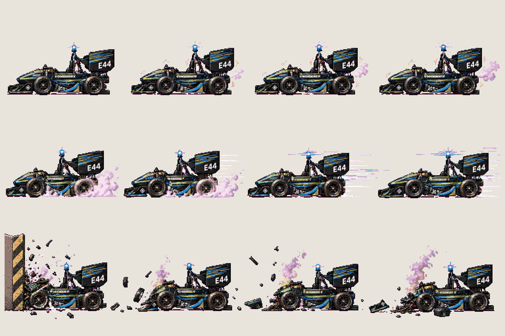
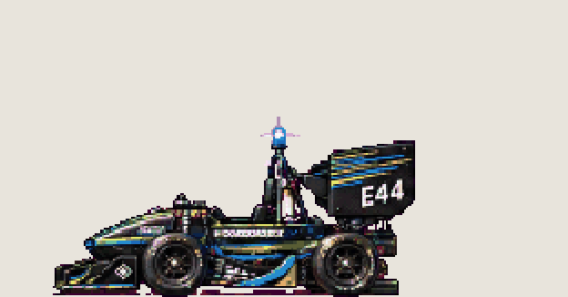
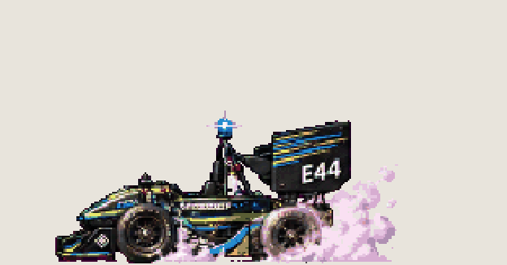
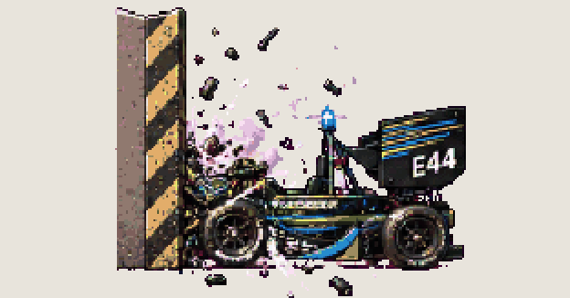

# Boss · Jenny, attacks

<!-- nav:start -->
[← FX · black fluid](fx.md) · [Sprite boards](README.md) · **16 / 28** · [Boss · Jenny, stunned and debris →](boss-jenny-2.md)
<!-- nav:end -->

**Review:** ✅ Approved 24 Oct by Alexander. 270 px long like the approved direction (docs/04), one livery in both sheets; exported to game/public/assets/sprites/ with export_atlas.py. The looping previews below are at twice game size.

## In motion

At twice game size, 12 fps unless the atlas says otherwise: rev, charge, crash.

  

## Brief

On a flat, solid, pure magenta #FF00FF background (no paper colour, no ground shadows, no dust under the feet), with NO text at all - no titles, no captions, no frame numbers, no labels under the figures: JENNY, Fast Forest's Formula Student race car (Jenny 16GDX) from the photos: an open-wheel single-seater in carbon black with lime-green, teal and blue stripes, the race number E44 on the nose, an EMPTY cockpit (nobody inside), and a small blue autonomous-status light on the roll hoop. She drives herself and is possessed. Strict side view, FACING LEFT, the same size in every frame, about four times as long as a person is tall. 3 rows. Row 1, exactly 4 frames: REV (stands still, the body shakes, the blue light flashes, exhaust puffs). Row 2, exactly 4 frames: CHARGE (rear wheels spin with smoke, launch forward with speed lines, full speed, leaning). Row 3, exactly 4 frames: CRASH into a wall on the left (the nose crumples, the car bounces back, parts fly off, smoke). Every frame stands on the SAME invisible ground line at the SAME scale. Each row's frames are evenly spaced from left to right with wide clear magenta gaps between neighbours, and rows are separated by empty magenta bands. Draw distinct key poses, never blurred in-betweens. Count the frames: each row has EXACTLY the number stated. No people, no scenery.

## Inputs

- `20261023_130003.jpg` (GameJam_References-2, outside Git)
- `20261023_130118.jpg` (GameJam_References-2, outside Git)
- `20261023_130123.jpg` (GameJam_References-2, outside Git)
- [boss-jenny-preview.png](../direction/images/boss-jenny-preview.png)
- [style-master-preview.png](../direction/images/style-master-preview.png)

Model `gpt-image-2.5-sunburst` · pixel factor 2 · source image `images/boss-jenny.png` · rebuild: `python scripts/make_boards.py draw boss-jenny --redo --config art/sprites/boards.json`

<!-- nav:start -->
[← FX · black fluid](fx.md) · [Sprite boards](README.md) · **16 / 28** · [Boss · Jenny, stunned and debris →](boss-jenny-2.md)
<!-- nav:end -->
