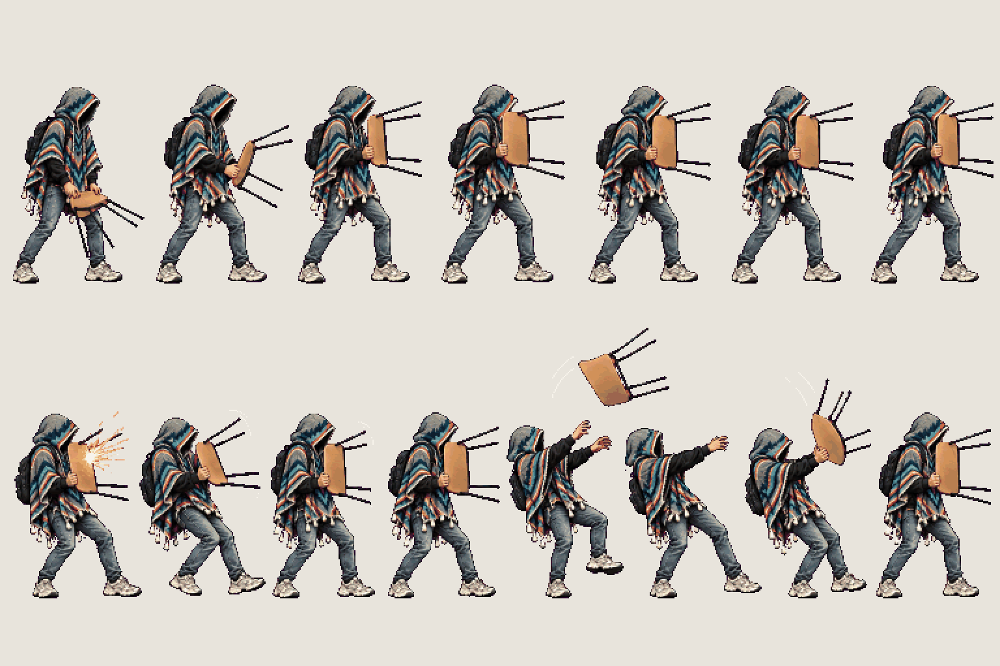
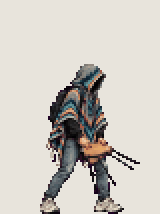
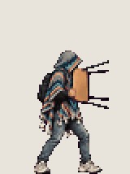
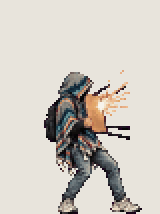
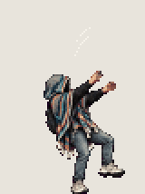

# Chair · block

<!-- nav:start -->
[← Chair · overhead slam](chair-overhead.md) · [Sprite boards](README.md) · **11 / 31** · [Enemy · drone →](enemy-drone.md)
<!-- nav:end -->

**Review:** ✅ Approved 23 Oct by Alexander. Counts match docs/07; exported to game/public/assets/sprites/ with export_atlas.py. The looping previews below are at twice game size.

## In motion

At twice game size, 12 fps unless the atlas says otherwise: guard-up, guard-hold, guard-impact, guard-break.

   

## Brief

On a flat, solid, pure magenta #FF00FF background (no paper colour, no ground shadows, no dust under the feet), with NO text at all - no titles, no captions, no frame numbers, no labels under the figures: Hero from the first image (keep the THD poncho, the shadow-filled hood and all proportions exactly), facing right, strict side view, identical scale in every frame. The weapon is the honey-coloured bent-plywood stacking chair with four thin black steel legs from the photos (the images after the first). It is LIGHT: the hero swings it quickly with both hands at the edge of the seat, snappy and short-range, never heavy or slow. Copy the grips and the wide low stance from the photos. 2 rows. Row 1, exactly 7 figures: GUARD UP, 4 frames (from ready to holding the chair seat in front of the chest like a shield with the four legs pointing forward at the enemy, as in the photos), then GUARD HOLD, 3 frames (a tiny breathing shift). Row 2, exactly 8 figures: GUARD IMPACT, 4 frames (a small spark on the seat, the hero skids back a little, the chair wobbles, steady again), then GUARD BREAK, 4 frames (the chair is knocked up and away, the hero stumbles back with arms out, then catches the chair again). The THD crest patch is on the poncho's BACK only and is never visible from the side. Every figure stands on the SAME invisible ground line, even airborne poses: the game moves the body, so never draw a figure higher up. Each row's figures are evenly spaced from left to right with wide clear magenta gaps between neighbours: no tassel, foot, hand or poncho edge touches the next figure, and rows are separated by empty magenta bands. Draw distinct key poses, never blurred in-betweens; neighbouring frames change by small continuous steps so they loop smoothly. Count the figures: each row has EXACTLY the number stated.

## Inputs

- [hero-preview.png](images/hero-preview.png)
- `20261023_130941.jpg` (GameJam_References-2, outside Git)
- `20261023_130958.jpg` (GameJam_References-2, outside Git)
- `20261023_130959(0).jpg` (GameJam_References-2, outside Git)
- `20261023_130959.jpg` (GameJam_References-2, outside Git)
- [style-master-preview.png](../direction/images/style-master-preview.png)

Model `gpt-image-2.5-sunburst` · pixel factor 2 · source image `images/chair-block.png` · rebuild: `python scripts/make_boards.py draw chair-block --redo --config art/sprites/boards.json`

<!-- nav:start -->
[← Chair · overhead slam](chair-overhead.md) · [Sprite boards](README.md) · **11 / 31** · [Enemy · drone →](enemy-drone.md)
<!-- nav:end -->
