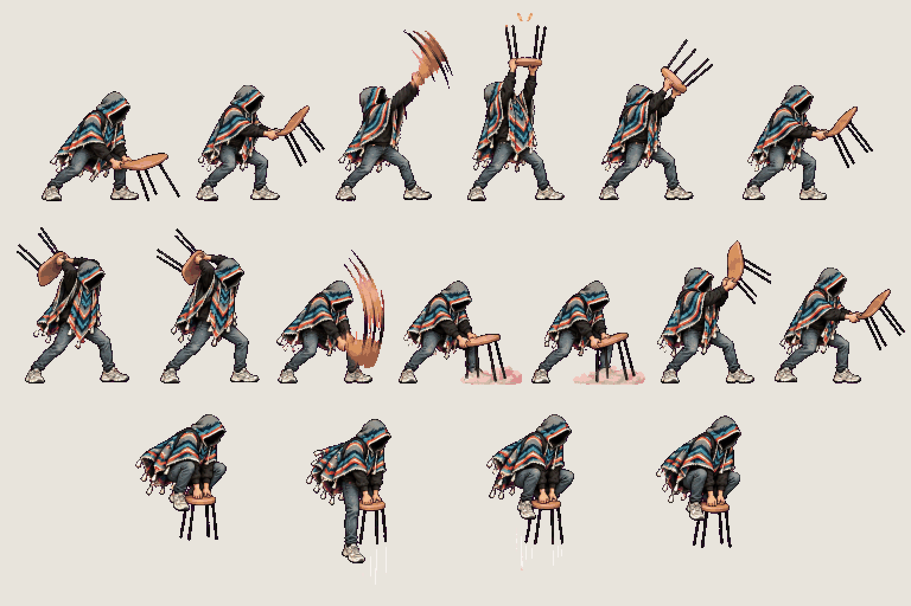
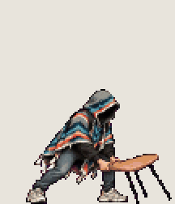
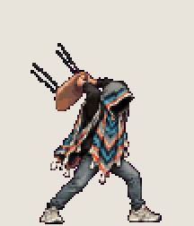
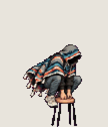

# Chair · overhead slam

<!-- nav:start -->
[← Chair · side sweep](chair-side.md) · [Sprite boards](README.md) · **10 / 31** · [Chair · block →](chair-block.md)
<!-- nav:end -->

**Review:** ✅ Approved 23 Oct by Alexander. Counts match docs/07; exported to game/public/assets/sprites/ with export_atlas.py. The looping previews below are at twice game size.

## In motion

At twice game size, 12 fps unless the atlas says otherwise: up, slam, pogo.

  

## Brief

On a flat, solid, pure magenta #FF00FF background (no paper colour, no ground shadows, no dust under the feet), with NO text at all - no titles, no captions, no frame numbers, no labels under the figures: Hero from the first image (keep the THD poncho, the shadow-filled hood and all proportions exactly), facing right, strict side view, identical scale in every frame. The weapon is the honey-coloured bent-plywood stacking chair with four thin black steel legs from the photos (the images after the first). It is LIGHT: the hero swings it quickly with both hands at the edge of the seat, snappy and short-range, never heavy or slow. Copy the grips and the wide low stance from the photos. 3 rows. Row 1, exactly 6 figures: UP ATTACK - crouch with the chair low, lift, ONE SMEAR frame upward, the chair thrust straight overhead seat-up with the legs to the sky and a small spark above, start lowering, ready. Row 2, exactly 7 figures: DOWN SLAM - chair raised high behind the head, peak, ONE SMEAR frame of the downward arc, the chair slammed upright onto the ground in front with a small puff of dust (no crack, no shockwave, no debris), a short hold, pull the chair back up, ready. Row 3, exactly 4 figures: AIR POGO - the hero in the air pointing the chair legs straight down below the feet: tuck, thrust down, bounce up off a hit, recover. The THD crest patch is on the poncho's BACK only and is never visible from the side. Every figure stands on the SAME invisible ground line, even airborne poses: the game moves the body, so never draw a figure higher up. Each row's figures are evenly spaced from left to right with wide clear magenta gaps between neighbours: no tassel, foot, hand or poncho edge touches the next figure, and rows are separated by empty magenta bands. Draw distinct key poses, never blurred in-betweens; neighbouring frames change by small continuous steps so they loop smoothly. Count the figures: each row has EXACTLY the number stated.

## Inputs

- [hero-preview.png](images/hero-preview.png)
- `20261023_130947.jpg` (GameJam_References-2, outside Git)
- `20261023_131008.jpg` (GameJam_References-2, outside Git)
- `20261023_131010.jpg` (GameJam_References-2, outside Git)
- `20261023_131010(0).jpg` (GameJam_References-2, outside Git)
- `20261023_130948.jpg` (GameJam_References-2, outside Git)
- [style-master-preview.png](../direction/images/style-master-preview.png)

Model `gpt-image-2.5-sunburst` · pixel factor 2 · source image `images/chair-overhead.png` · rebuild: `python scripts/make_boards.py draw chair-overhead --redo --config art/sprites/boards.json`

<!-- nav:start -->
[← Chair · side sweep](chair-side.md) · [Sprite boards](README.md) · **10 / 31** · [Chair · block →](chair-block.md)
<!-- nav:end -->
