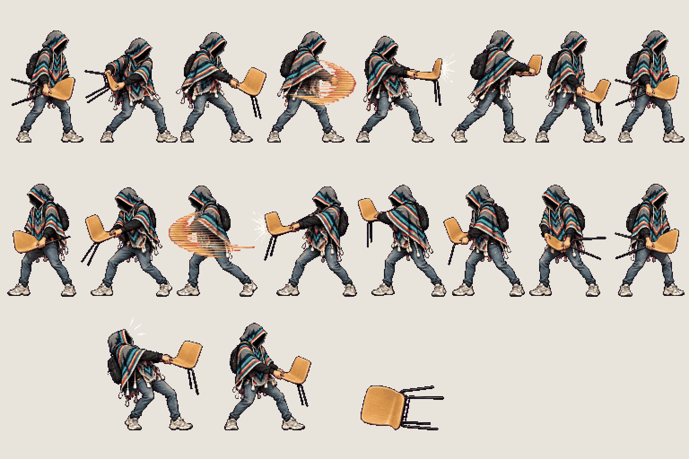
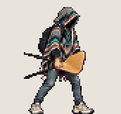
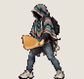
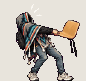
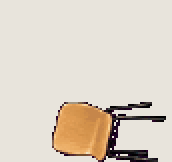

# Chair · side sweep

<!-- nav:start -->
[← The student · jump, fall, climb](hero-air.md) · [Sprite boards](README.md) · **8 / 10** · [Chair · overhead slam →](chair-overhead.md)
<!-- nav:end -->

**Review:** 🟡 Drawn 23 Oct, waiting for Alexander's Design review.

## In motion

At twice game size, 12 fps unless the atlas says otherwise: sweep-a, sweep-b, recoil, chair-pickup.

   

## Brief

On a flat, solid, pure magenta #FF00FF background (no paper colour, no ground shadows, no dust under the feet), with NO text at all - no titles, no captions, no frame numbers, no labels under the figures: Hero from the first image (keep the THD poncho, the shadow-filled hood and all proportions exactly), facing right, strict side view, identical scale in every frame. The weapon is the honey-coloured bent-plywood stacking chair with four thin black steel legs from the photos (the images after the first). It is LIGHT: the hero swings it quickly with both hands at the edge of the seat, snappy and short-range, never heavy or slow. Copy the grips and the wide low stance from the photos. 3 rows. Row 1, exactly 8 figures: SWEEP A, a horizontal forehand swing - ready (chair held by the seat at hip height, legs pointing back), wind-up turning the body back, swing start, ONE SMEAR frame (the chair stretched into a blurred pixel arc), contact (chair fully extended in front at waist height with a small white impact spark), follow-through past the body, settle, ready. Row 2, exactly 8 figures: SWEEP B, the return backhand swing the other way, starting where sweep A ended - wind-up, swing start, ONE SMEAR frame, contact with a small spark, follow-through, settle, ready. Row 3, exactly 3 items: RECOIL, 2 frames (the chair bounces back off something hard and the hero leans back, then steadies), then THE CHAIR ALONE lying on its side on the ground (no hero), at the same pixel scale. The THD crest patch is on the poncho's BACK only and is never visible from the side. Every figure stands on the SAME invisible ground line, even airborne poses: the game moves the body, so never draw a figure higher up. Each row's figures are evenly spaced from left to right with wide clear magenta gaps between neighbours: no tassel, foot, hand or poncho edge touches the next figure, and rows are separated by empty magenta bands. Draw distinct key poses, never blurred in-betweens; neighbouring frames change by small continuous steps so they loop smoothly. Count the figures: each row has EXACTLY the number stated.

## Inputs

- [hero-preview.png](images/hero-preview.png)
- `20261023_130947(0).jpg` (GameJam_References-2, outside Git)
- `20261023_131010(1).jpg` (GameJam_References-2, outside Git)
- `20261023_131011.jpg` (GameJam_References-2, outside Git)
- `20261023_130804.jpg` (GameJam_References-2, outside Git)
- [style-master-preview.png](../direction/images/style-master-preview.png)

Model `gpt-image-2.5-sunburst` · pixel factor 2 · source image `images/chair-side.png` · rebuild: `python scripts/make_boards.py draw chair-side --redo --config art/sprites/boards.json`

<!-- nav:start -->
[← The student · jump, fall, climb](hero-air.md) · [Sprite boards](README.md) · **8 / 10** · [Chair · overhead slam →](chair-overhead.md)
<!-- nav:end -->
