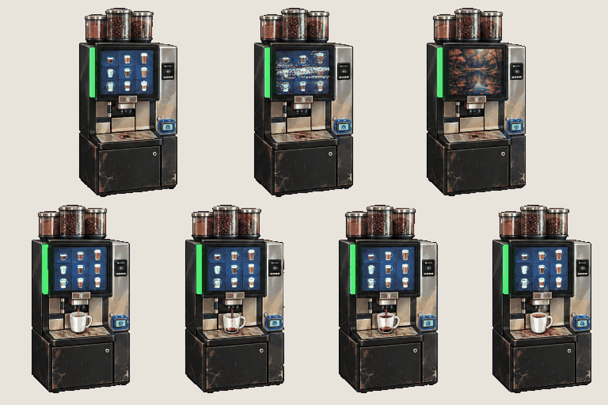
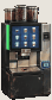
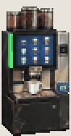

# Prop · coffee machine (save point)

<!-- nav:start -->
[← Mensa · food pickups](mensa-food.md) · [Sprite boards](README.md) · **20 / 31** · [Dexter · moves →](dexter.md)
<!-- nav:end -->

**Review:** ✅ Approved 24 Oct by Alexander (#154); exported to game/public/assets/sprites/ with export_atlas.py. 42 × 80 px in the game: fills the 40 × 80 coffee-1 box in Rusty Creek, a little taller than the 76 px hero on its base cabinet, as in the photos. Lineup in the stage: previews/coffee-visit-lineup.png.

## In motion

At twice game size, 12 fps unless the atlas says otherwise: idle, pour.

 

## Brief

On a flat, solid, pure magenta #FF00FF background (no paper colour, no ground shadows, no dust under the objects), with NO text at all - no titles, no captions, no frame numbers, no labels, no readable brand names: Prop sprite sheet: the self-service coffee machine from the first two photos, copied exactly - black and brushed-steel body, three steel bean hoppers on top, a big glowing touchscreen with a grid of drink buttons, a bright green light strip down its left side, a steel drip tray and spout - standing on its own black base cabinet so the whole unit is a little TALLER than an adult (about 190 cm) and about half as wide as it is tall. Real wear: fingerprints, a coffee stain on the tray, a scuffed cabinet. Strict front-three-quarter side view, the same in every frame. 2 rows. Row 1, exactly 3 frames: IDLE, the screen glowing steadily, then the screen FLICKERING (a band of static across it), then the screen showing a still dark POND image for one frame (an anomaly hint). Row 2, exactly 4 frames: POUR, a white cafeteria mug under the spout fills with coffee in 4 steps, a little steam on the last. Every frame stands on the SAME invisible ground line at the SAME scale. Each row's frames are evenly spaced from left to right with wide clear magenta gaps between neighbours, and rows are separated by empty magenta bands. Draw distinct key poses, never blurred in-betweens. Count the frames: each row has EXACTLY the number stated. No people, no scenery.

## Inputs

- `20261023_125138.jpg` (GameJam_References-2, outside Git)
- `20261023_125141.jpg` (GameJam_References-2, outside Git)
- [style-master-preview.png](../direction/images/style-master-preview.png)

Model `gpt-image-2.5-sunburst` · pixel factor 2 · source image `images/coffee-machine.png` · rebuild: `python scripts/make_boards.py draw coffee-machine --redo --config art/sprites/boards.json`

<!-- nav:start -->
[← Mensa · food pickups](mensa-food.md) · [Sprite boards](README.md) · **20 / 31** · [Dexter · moves →](dexter.md)
<!-- nav:end -->
