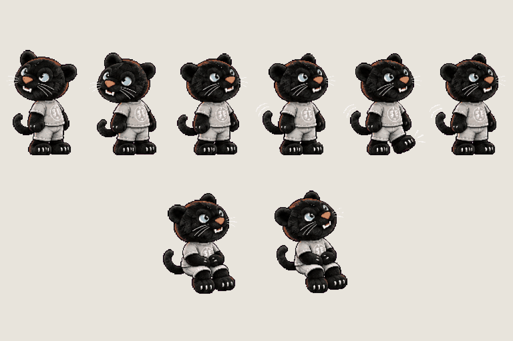
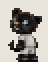
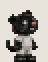
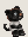

# Dexter · prologue additions

<!-- nav:start -->
[← FX · pond ripples and lily pad](fx-water.md) · [Sprite boards](README.md) · **26 / 32** · [Menu · the Hidden Garden at first light →](menu-key.md)
<!-- nav:end -->

**Review:** ✅ Approved 24 Oct by Alexander; exported to game/public/assets/sprites/ with export_atlas.py.

## In motion

At twice game size, 12 fps unless the atlas says otherwise: look-back, wait, sit.

  

## Brief

On a flat, solid, pure magenta #FF00FF background (no paper colour, no ground shadows, no dust under the feet), with NO text at all - no titles, no captions, no frame numbers, no labels under the figures: DEXTER, the university's black panther mascot as the small PLUSH toy from the first two images (an approved sprite sheet of him from this game, then his approved design) - copy that plush exactly: CHUNKY toy proportions, a BIG round head about 45 % of his whole height, wide rounded ears, big ice-blue eyes, an orange nose, small white fangs, long white whiskers, a short soft body in a light-grey THD crest T-shirt and light-grey shorts, short stubby black arms and legs, big black paw feet with white claw dots, a short curled tail. Black velvet fur with soft dark-grey highlights so the shapes read at small size. A cute, slightly too-alive plush that moves by itself - never slim, never a cat on two legs, never a human body. Strict side view, facing RIGHT, the head turned a little toward the viewer so both eyes show, the same size in every frame as on the approved sheet. He never talks: everything is body language. These are the poses his approved sheet (image 1) is missing for the first quest. 2 rows. Row 1, exactly 6 frames: LOOK BACK, 3 frames (standing, facing right, he turns his big head back over his shoulder toward the viewer and the left, then holds the look), then WAIT, 3 frames (standing, facing right, he taps one foot and his tail swishes, impatient but friendly). Row 2, exactly 2 frames: SIT, Dexter sitting on an invisible bench edge with his stubby legs dangling down in front, paws in his lap, facing right - frame 1 still, frame 2 his head tilted and the tail curled the other way. Draw the seat as nothing: he sits in the air at the height of a bench seat, his legs hanging. Every standing frame stands on the SAME invisible ground line at the SAME scale. Each row's frames are evenly spaced from left to right with wide clear magenta gaps between neighbours, and rows are separated by empty magenta bands. Draw distinct key poses, never blurred in-betweens. Count the frames: each row has EXACTLY the number stated. No people, no bench, no scenery.

## Inputs

- [dexter-preview.png](images/dexter-preview.png)
- [dexter-stages-preview.png](../direction/images/dexter-stages-preview.png), cropped to `535,585,125,205`
- [dexter-stages-preview.png](../direction/images/dexter-stages-preview.png), cropped to `290,225,390,570`
- `Deggster-9487_1280x1280.jpg` (GameJam_Merch, outside Git)
- [style-master-preview.png](../direction/images/style-master-preview.png)

Model `gpt-image-2.5-sunburst` · pixel factor 2 · source image `images/dexter-prologue.png` · rebuild: `python scripts/make_boards.py draw dexter-prologue --redo --config art/sprites/boards.json`

<!-- nav:start -->
[← FX · pond ripples and lily pad](fx-water.md) · [Sprite boards](README.md) · **26 / 32** · [Menu · the Hidden Garden at first light →](menu-key.md)
<!-- nav:end -->
