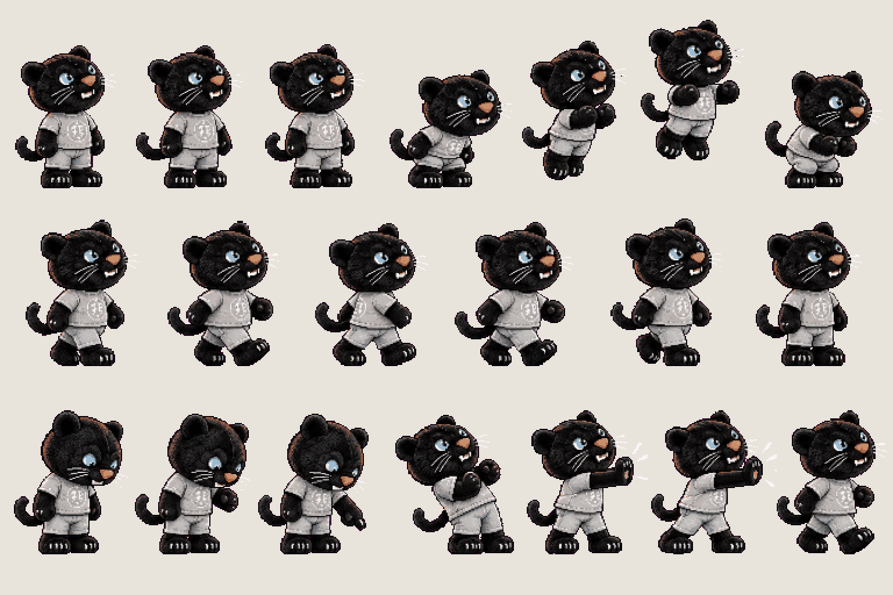
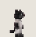
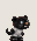
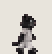
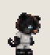
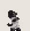

# Dexter · moves

<!-- nav:start -->
[← Prop · coffee machine (save point)](coffee-machine.md) · [Sprite boards](README.md) · **21 / 31** · [Dexter · gestures →](dexter-acts.md)
<!-- nav:end -->

**Review:** ✅ Approved 24 Oct by Alexander (#141). 27 px = 0.35 of the hero as in the approved Dexter stages (docs/04, compare.py lineup); exported to game/public/assets/sprites/ with export_atlas.py. The looping previews below are at twice game size.

## In motion

At twice game size, 12 fps unless the atlas says otherwise: idle, hop, walk, point, shove.

    

## Brief

On a flat, solid, pure magenta #FF00FF background (no paper colour, no ground shadows, no dust under the feet), with NO text at all - no titles, no captions, no frame numbers, no labels under the figures: DEXTER, the university's black panther mascot as the small PLUSH toy from the first two images - copy that plush exactly: CHUNKY toy proportions, a BIG round head about 45 % of his whole height, wide rounded ears, big ice-blue eyes, an orange nose, small white fangs, long white whiskers, a short soft body in a light-grey THD crest T-shirt and light-grey shorts, short stubby black arms and legs, big black paw feet with white claw dots, a short curled tail. Black velvet fur with soft dark-grey highlights so the shapes read at small size. A cute, slightly too-alive plush that moves by itself. The second image shows his size: he reaches just above the hero's knee - never slim, never a cat on two legs, never a human body. Strict side view, facing RIGHT, the head turned a little toward the viewer so both eyes show, the same size in every frame. He never talks: everything is body language. 3 rows. Row 1, exactly 7 frames: IDLE, 3 frames (a small breathing bob, the tail flicks), then HOP, 4 frames (crouch, spring up, in the air, land). Row 2, exactly 6 frames: WALK cycle on two legs, a waddling plush walk. Row 3, exactly 7 frames: POINT AT THE GROUND, 3 frames (looks down, raises one paw, points down firmly), then SHOVE, 4 frames (leans back, both paws push forward hard, holds, steps back). Every frame stands on the SAME invisible ground line at the SAME scale. Each row's frames are evenly spaced from left to right with wide clear magenta gaps between neighbours, and rows are separated by empty magenta bands. Draw distinct key poses, never blurred in-betweens. Count the frames: each row has EXACTLY the number stated. No people, no scenery.

## Inputs

- [dexter-stages-preview.png](../direction/images/dexter-stages-preview.png), cropped to `535,585,125,205`
- [dexter-stages-preview.png](../direction/images/dexter-stages-preview.png), cropped to `290,225,390,570`
- `Deggster-9487_1280x1280.jpg` (GameJam_Merch, outside Git)
- `Deggster-9493_1280x1280.jpg` (GameJam_Merch, outside Git)
- `Deggster-9499_1280x1280.jpg` (GameJam_Merch, outside Git)
- [style-master-preview.png](../direction/images/style-master-preview.png)

Model `gpt-image-2.5-sunburst` · pixel factor 2 · source image `images/dexter.png` · rebuild: `python scripts/make_boards.py draw dexter --redo --config art/sprites/boards.json`

<!-- nav:start -->
[← Prop · coffee machine (save point)](coffee-machine.md) · [Sprite boards](README.md) · **21 / 31** · [Dexter · gestures →](dexter-acts.md)
<!-- nav:end -->
