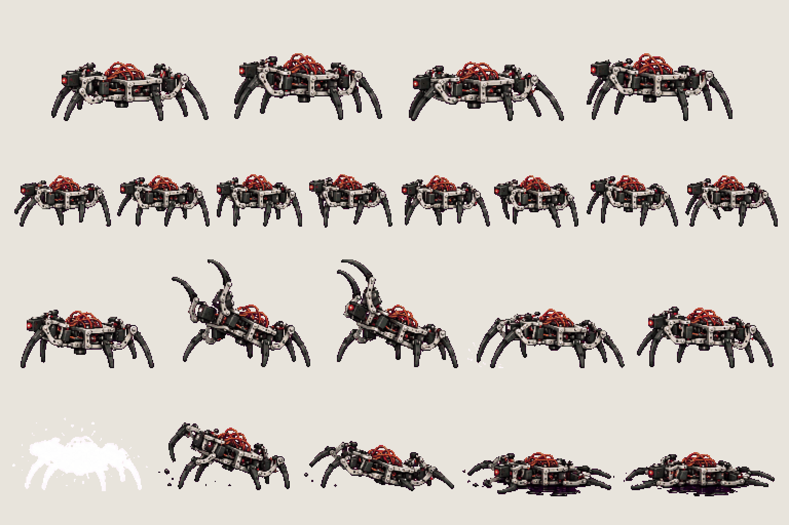
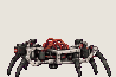
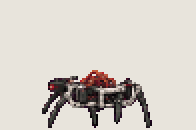
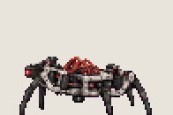
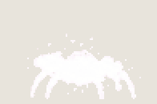

# Enemy · crab

<!-- nav:start -->
[← Enemy · rover](enemy-rover.md) · [Sprite boards](README.md) · **14 / 28** · [FX · black fluid →](fx.md)
<!-- nav:end -->

**Review:** ✅ Approved 23 Oct by Alexander. Counts match docs/07; exported to game/public/assets/sprites/ with export_atlas.py. The looping previews below are at twice game size.

## In motion

At twice game size, 12 fps unless the atlas says otherwise: idle, walk, stab, collapse.

   

## Brief

On a flat, solid, pure magenta #FF00FF background (no paper colour, no ground shadows, no dust under the feet), with NO text at all - no titles, no captions, no frame numbers, no labels under the figures: Enemy sprite sheet of the autonomous six-legged hexapod robot from the photos (a flat electronics body, six jointed servo legs, wiring and small sensors), waist-high and wide like a crab. Nobody controls it: it is autonomous and now hostile, with one small red sensor light. Strict side view, FACING LEFT. 4 rows. Row 1, exactly 4 frames: IDLE (legs shift, body bobs). Row 2, exactly 8 frames: WALK cycle (legs move in alternating tripods). Row 3, exactly 5 frames: REAR AND STAB (raises the two front legs high, holds, stabs them down forward, pulls back). Row 4, exactly 5 frames: COLLAPSE (white hit-flash silhouette, legs buckle, body drops flat, legs splay out, stops dead with a small pool of glossy black fluid). Every frame stands on the SAME invisible ground line at the SAME scale. Each row's frames are evenly spaced from left to right with wide clear magenta gaps between neighbours, and rows are separated by empty magenta bands. Draw distinct key poses, never blurred in-betweens. Count the frames: each row has EXACTLY the number stated. No people, no hero, no scenery.

## Inputs

- `20261023_125939.jpg` (GameJam_References-2, outside Git)
- `20261023_125941.jpg` (GameJam_References-2, outside Git)
- `20261023_125944.jpg` (GameJam_References-2, outside Git)
- [cast-preview.png](../direction/images/cast-preview.png)
- [style-master-preview.png](../direction/images/style-master-preview.png)

Model `gpt-image-2.5-sunburst` · pixel factor 2 · source image `images/enemy-crab.png` · rebuild: `python scripts/make_boards.py draw enemy-crab --redo --config art/sprites/boards.json`

<!-- nav:start -->
[← Enemy · rover](enemy-rover.md) · [Sprite boards](README.md) · **14 / 28** · [FX · black fluid →](fx.md)
<!-- nav:end -->
