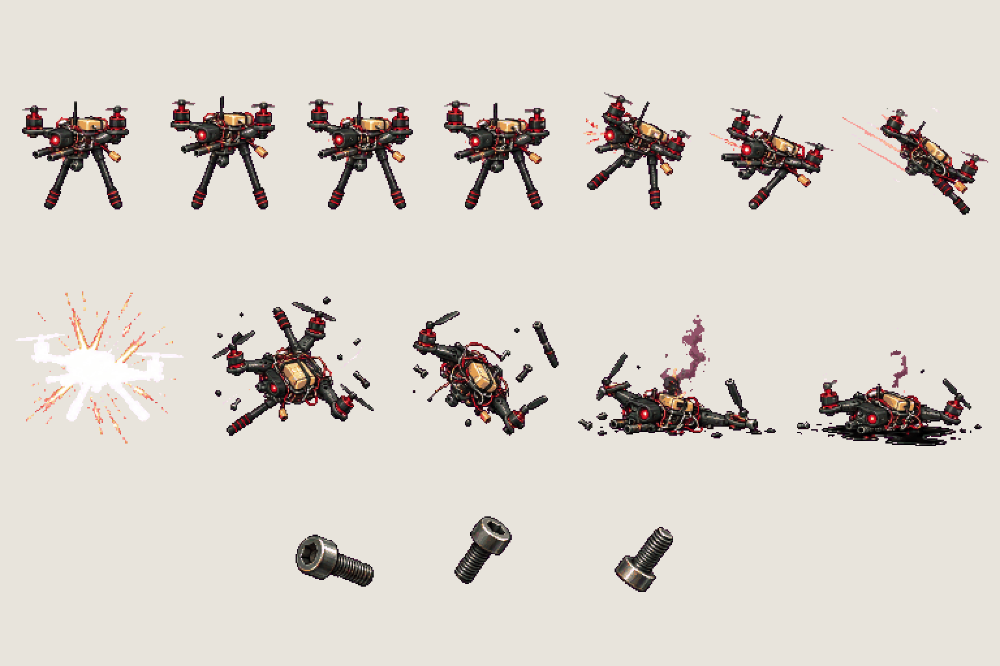
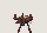
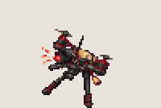
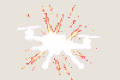
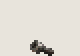

# Enemy · drone

<!-- nav:start -->
[← Chair · block](chair-block.md) · [Sprite boards](README.md) · **12 / 32** · [Enemy · rover →](enemy-rover.md)
<!-- nav:end -->

**Review:** ✅ Approved 23 Oct by Alexander. Counts match docs/07; exported to game/public/assets/sprites/ with export_atlas.py. The looping previews below are at twice game size.

## In motion

At twice game size, 12 fps unless the atlas says otherwise: hover, dive, crash, screw.

   

## Brief

On a flat, solid, pure magenta #FF00FF background (no paper colour, no ground shadows, no dust under the feet), with NO text at all - no titles, no captions, no frame numbers, no labels under the figures: Enemy sprite sheet of the big black carbon-fibre autonomous quadcopter from the photos (four long arms, red-and-black motors, two-bladed props, tall black landing legs, exposed wiring and a small electronics deck in the middle), now hostile, with ONE red sensor eye on the deck. Strict side view, FACING LEFT. 3 rows. Row 1, exactly 7 frames: HOVER loop, 4 frames (props as blur discs, the body bobs 1-2 pixels), then ALERT AND DIVE, 3 frames (the eye flashes, it tilts forward, dives with a short speed trail). Row 2, exactly 5 frames: CRASH (white hit-flash silhouette, knocked sideways and spinning, falling, wreck on the ground with one prop twitching, a little smoke and a small pool of glossy black fluid). Row 3, exactly 3 frames: a small DROPPED SCREW tumbling, drawn large enough to read. Every frame stands on the SAME invisible ground line at the SAME scale. Each row's frames are evenly spaced from left to right with wide clear magenta gaps between neighbours, and rows are separated by empty magenta bands. Draw distinct key poses, never blurred in-betweens. Count the frames: each row has EXACTLY the number stated. No people, no hero, no scenery.

## Inputs

- `20261023_135552.jpg` (GameJam_References-2, outside Git)
- `20261023_135554.jpg` (GameJam_References-2, outside Git)
- `20261023_135556.jpg` (GameJam_References-2, outside Git)
- `20261023_135558.jpg` (GameJam_References-2, outside Git)
- [cast-preview.png](../direction/images/cast-preview.png)
- [style-master-preview.png](../direction/images/style-master-preview.png)

Model `gpt-image-2.5-sunburst` · pixel factor 2 · source image `images/enemy-drone.png` · rebuild: `python scripts/make_boards.py draw enemy-drone --redo --config art/sprites/boards.json`

<!-- nav:start -->
[← Chair · block](chair-block.md) · [Sprite boards](README.md) · **12 / 32** · [Enemy · rover →](enemy-rover.md)
<!-- nav:end -->
