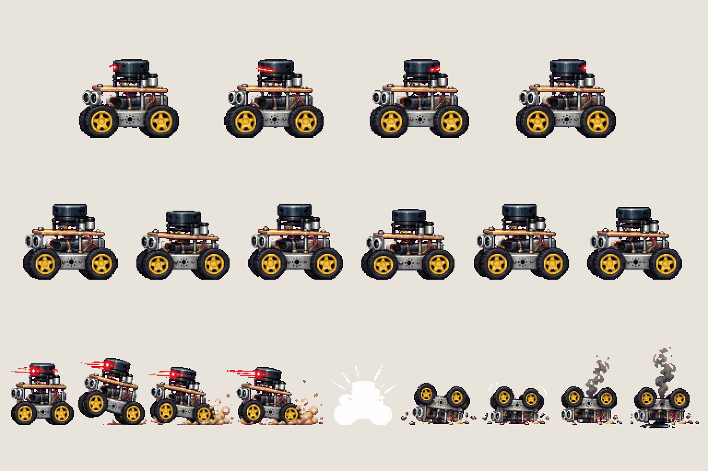
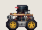
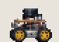
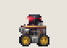
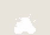

# Enemy · rover

<!-- nav:start -->
[← Enemy · drone](enemy-drone.md) · [Sprite boards](README.md) · **12 / 14** · [Enemy · crab →](enemy-crab.md)
<!-- nav:end -->

**Review:** ✅ Approved 23 Oct by Alexander. Counts match docs/07; exported to game/public/assets/sprites/ with export_atlas.py. The looping previews below are at twice game size.

## In motion

At twice game size, 12 fps unless the atlas says otherwise: idle, drive, charge, wreck.

   

## Brief

On a flat, solid, pure magenta #FF00FF background (no paper colour, no ground shadows, no dust under the feet), with NO text at all - no titles, no captions, no frame numbers, no labels under the figures: Enemy sprite sheet of the small four-wheeled autonomous lab rover from the photos (aluminium chassis, four chunky yellow wheels with black tyres, plywood top deck, a black cylindrical lidar on top, two round ultrasonic sensor 'eyes' at the front). Nobody drives it: it is autonomous and now hostile. Strict side view, FACING LEFT. 3 rows. Row 1, exactly 4 frames: IDLE (the lidar spins, the body hums). Row 2, exactly 6 frames: DRIVE patrol cycle (wheels turn, chassis bounces 1 pixel). Row 3, exactly 9 frames: SPOT AND CHARGE, 4 frames (the lidar flashes red, it rears up a little, lunges forward with dust from the wheels), then HIT, FLIP AND WRECK, 5 frames (white hit-flash silhouette, flipped onto its back, wheels spinning, stops dead, a little smoke and a small pool of glossy black fluid). Every frame stands on the SAME invisible ground line at the SAME scale. Each row's frames are evenly spaced from left to right with wide clear magenta gaps between neighbours, and rows are separated by empty magenta bands. Draw distinct key poses, never blurred in-betweens. Count the frames: each row has EXACTLY the number stated. No people, no hero, no scenery.

## Inputs

- `20261023_125948.jpg` (GameJam_References-2, outside Git)
- `20261023_125951.jpg` (GameJam_References-2, outside Git)
- `20261023_125952.jpg` (GameJam_References-2, outside Git)
- [cast-preview.png](../direction/images/cast-preview.png)
- [style-master-preview.png](../direction/images/style-master-preview.png)

Model `gpt-image-2.5-sunburst` · pixel factor 2 · source image `images/enemy-rover.png` · rebuild: `python scripts/make_boards.py draw enemy-rover --redo --config art/sprites/boards.json`

<!-- nav:start -->
[← Enemy · drone](enemy-drone.md) · [Sprite boards](README.md) · **12 / 14** · [Enemy · crab →](enemy-crab.md)
<!-- nav:end -->
