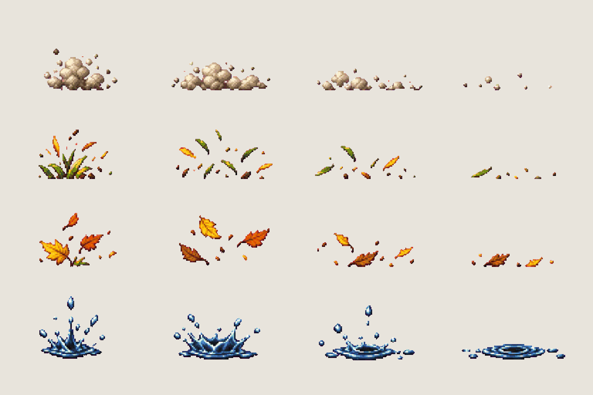

# FX · footstep puffs

<!-- nav:start -->
[← FX · falling leaves](fx-leaves.md) · [Sprite boards](README.md) · **24 / 31** · [FX · pond ripples and lily pad →](fx-water.md)
<!-- nav:end -->

**Review:** 🟡 Drawn 24 Oct for the prologue (workstream 5); exported for the slice, awaiting Alexander's review. Dust 21–30 × 5–12 px, grass and leaf kick ≈ 25 × 14, splash ≈ 25 × 16 – about one step wide next to the 76 px hero. Rows are `even` (they break into specks).

## In motion

At twice game size, 12 fps unless the atlas says otherwise: dust, grass, leaf-kick, splash.

   

## Brief

On a flat, solid, pure magenta #FF00FF background (no paper colour, no ground shadows, no dust under the objects), with NO text at all - no titles, no captions, no frame numbers, no labels, no arrows: Image 1 is an approved effect sprite sheet from this game: draw this sheet in exactly that pixel-art look and sheet layout - small sprites in rows on magenta. Effect sprite sheet: small puffs kicked up by a footstep or a landing on the ground of the Hidden Garden (images 2 to 4: the stone-slab path, the grass with yellow leaves, the pond edge). Every effect sits ON the ground line and bursts up and outward from one point, seen from the side, low and wide (about twice as wide as tall), and fades out by breaking into specks. 4 rows. Row 1, exactly 4 frames: DUST, a soft warm grey-beige dust puff - small burst, round cloud, wider thinner cloud, a few last specks. Row 2, exactly 4 frames: GRASS, a few green and straw-yellow grass blades and seeds flicked up and falling back. Row 3, exactly 4 frames: LEAF KICK, three or four tiny yellow and orange leaves kicked up in an arc and settling. Row 4, exactly 4 frames: SPLASH, a small blue-white water splash with droplets, crown, droplets falling, a flat ring. All effects at the SAME scale. Each row's frames are evenly spaced from left to right with wide clear magenta gaps between neighbours, and rows are separated by empty magenta bands. Draw distinct key poses, never blurred in-betweens. Count the frames: each row has EXACTLY the number stated. No people, no hero, no scenery.

## Inputs

- [fx-preview.png](images/fx-preview.png)
- [hg-0-0.png](../stages/hidden-garden/images/hg-0-0.png), cropped to `560,380,560,100`
- [hidden-gardens.png](../../references/campus/images/hidden-gardens.png), cropped to `435,700,630,240`
- [hg-4-0.png](../stages/hidden-garden/images/hg-4-0.png), cropped to `0,440,700,120`
- [style-master-preview.png](../direction/images/style-master-preview.png)

Model `gpt-image-2.5-sunburst` · pixel factor 2 · source image `images/fx-ground.png` · rebuild: `python scripts/make_boards.py draw fx-ground --redo --config art/sprites/boards.json`

<!-- nav:start -->
[← FX · falling leaves](fx-leaves.md) · [Sprite boards](README.md) · **24 / 31** · [FX · pond ripples and lily pad →](fx-water.md)
<!-- nav:end -->
