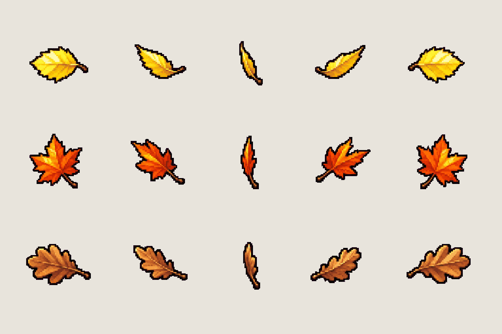

# FX · falling leaves

<!-- nav:start -->
[← Dexter · gestures](dexter-acts.md) · [Sprite boards](README.md) · **23 / 31** · [FX · footstep puffs →](fx-ground.md)
<!-- nav:end -->

**Review:** 🟡 Drawn 24 Oct for the prologue (workstream 5); exported for the slice, awaiting Alexander's review. Second draw: the first take's thin outlines and fine veins melted into the orange trees at 8 px (6 of 8 test frames LOW in scripts/readability.py); thick dark outlines and lighter fills brought it to 2 of 8. 7–10 px in the game.

## In motion

At twice game size, 12 fps unless the atlas says otherwise: birch, maple, oak.

  

## Brief

On a flat, solid, pure magenta #FF00FF background (no paper colour, no ground shadows, no dust under the objects), with NO text at all - no titles, no captions, no frame numbers, no labels, no arrows: Image 1 is an approved effect sprite sheet from this game: draw this sheet in exactly that pixel-art look and sheet layout - small sprites in rows on magenta. Effect sprite sheet: single FALLING AUTUMN LEAVES that tumble through the Hidden Garden, copied from the leaves in images 2 to 4 (the floating maple leaves on the pond, the yellow leaves in the grass, the willow screen). Each leaf is drawn LARGE and simple because the game shows it only 8 pixels tall, in front of orange and dark autumn trees: a THICK very dark brown-black outline all the way round (as thick as the stem), a bright, saturated, LIGHT fill (a pale lemon birch, a vivid red-orange maple, a warm tan oak) with one light highlight side, no fine veins, a short thick stem. The silhouette must read against both bright orange foliage and dark shadows. 3 rows, each row is ONE leaf kind tumbling as it falls, seen from the side: the leaf turns over in the air - flat face, tilted, edge-on thin sliver, tilted the other way, the back face. Row 1, exactly 5 frames: a small oval BIRCH leaf, bright lemon yellow. Row 2, exactly 5 frames: a five-pointed MAPLE leaf, orange to red. Row 3, exactly 5 frames: a round-lobed OAK leaf, russet brown. All leaves the SAME size, centred on one line. Each row's frames are evenly spaced from left to right with wide clear magenta gaps between neighbours, and rows are separated by empty magenta bands. Draw distinct key poses, never blurred in-betweens. Count the frames: each row has EXACTLY the number stated. No people, no hero, no scenery.

## Inputs

- [fx-preview.png](images/fx-preview.png)
- [hg-4-0.png](../stages/hidden-garden/images/hg-4-0.png), cropped to `520,470,900,230`
- [hidden-gardens.png](../../references/campus/images/hidden-gardens.png), cropped to `435,700,630,240`
- [hidden-gardens.png](../../references/campus/images/hidden-gardens.png), cropped to `20,1010,510,310`
- [style-master-preview.png](../direction/images/style-master-preview.png)

Model `gpt-image-2.5-sunburst` · pixel factor 2 · source image `images/fx-leaves.png` · rebuild: `python scripts/make_boards.py draw fx-leaves --redo --config art/sprites/boards.json`

<!-- nav:start -->
[← Dexter · gestures](dexter-acts.md) · [Sprite boards](README.md) · **23 / 31** · [FX · footstep puffs →](fx-ground.md)
<!-- nav:end -->
