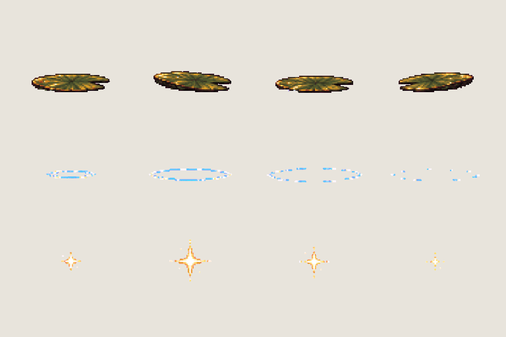

# FX · pond ripples and lily pad

<!-- nav:start -->
[← FX · footstep puffs](fx-ground.md) · [Sprite boards](README.md) · **25 / 29** · [Dexter · prologue additions →](dexter-prologue.md)
<!-- nav:end -->

**Review:** 🟡 Drawn 24 Oct for the prologue (workstream 5); exported for the slice, awaiting Alexander's review. Lily pad 58 × 14–16 px, measured against the painted pads in hg-4-0 (≈ 68 × 14–17); ripple 37–71 px wide; sparkle halved to a 12 px glint. The plate's pads are browner than this olive pad – tint in code if it stands out.

## In motion

At twice game size, 12 fps unless the atlas says otherwise: lily-bob, ripple, sparkle.

  

## Brief

On a flat, solid, pure magenta #FF00FF background (no paper colour, no ground shadows, no dust under the objects), with NO text at all - no titles, no captions, no frame numbers, no labels, no arrows: Image 1 is an approved effect sprite sheet from this game: draw this sheet in exactly that pixel-art look and sheet layout - small sprites in rows on magenta. Effect sprite sheet for the Hidden Garden pond (images 2 and 3: its lily pads, its blue water with warm orange reflections and white glints). 3 rows. Row 1, exactly 4 frames: LILY PAD BOB, one dark olive-green round lily pad with a notch, seen almost edge-on from the side like in image 2 (a flat ellipse about four times as wide as tall), bobbing on the water - level, tipped a little left, level and a little lower, tipped a little right. Row 2, exactly 4 frames: RIPPLE, a ring on the water seen from the side as a flat ellipse made of thin light-blue and white pixel lines, growing wider and fainter: small ring, wider ring, wide broken ring, a few faint dashes. Row 3, exactly 4 frames: SPARKLE, a sun glint on the water, a small white-gold four-point twinkle that grows, flares, shrinks and fades. Keep the lily pads and ripples the SAME width as each other. Each row's frames are evenly spaced from left to right with wide clear magenta gaps between neighbours, and rows are separated by empty magenta bands. Draw distinct key poses, never blurred in-betweens. Count the frames: each row has EXACTLY the number stated. No people, no hero, no scenery.

## Inputs

- [fx-preview.png](images/fx-preview.png)
- [hg-4-0.png](../stages/hidden-garden/images/hg-4-0.png), cropped to `280,560,1000,160`
- [hg-0-0.png](../stages/hidden-garden/images/hg-0-0.png), cropped to `1000,480,1000,180`
- [style-master-preview.png](../direction/images/style-master-preview.png)

Model `gpt-image-2.5-sunburst` · pixel factor 2 · source image `images/fx-water.png` · rebuild: `python scripts/make_boards.py draw fx-water --redo --config art/sprites/boards.json`

<!-- nav:start -->
[← FX · footstep puffs](fx-ground.md) · [Sprite boards](README.md) · **25 / 29** · [Dexter · prologue additions →](dexter-prologue.md)
<!-- nav:end -->
