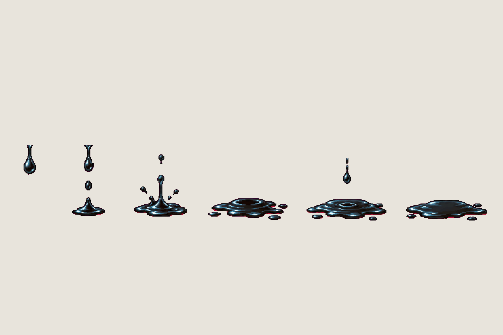
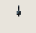

# FX · black fluid

<!-- nav:start -->
[← Enemy · crab](enemy-crab.md) · [Sprite boards](README.md) · **14 / 14** · [Sprite boards →](README.md)
<!-- nav:end -->

**Review:** ✅ Approved 23 Oct by Alexander. Counts match docs/07; exported to game/public/assets/sprites/ with export_atlas.py. The looping previews below are at twice game size.

## In motion

At twice game size, 12 fps unless the atlas says otherwise: black-fluid.

## Brief

On a flat, solid, pure magenta #FF00FF background (no paper colour, no ground shadows, no dust under the feet), with NO text at all - no titles, no captions, no frame numbers, no labels under the figures: Effect sprite sheet: the BLACK FLUID that leaks from a defeated machine. Glossy black liquid like crude oil with a faint cold blue sheen on the highlights, never red, never blood, never a goo monster. 1 row, exactly 6 frames, side view at ground level: a first drip falls from a seam, more drips, a small puddle forms on the ground, the puddle spreads wider, a last slow drip, the settled glossy puddle. Every frame stands on the SAME invisible ground line at the SAME scale. Each row's frames are evenly spaced from left to right with wide clear magenta gaps between neighbours, and rows are separated by empty magenta bands. Draw distinct key poses, never blurred in-betweens. Count the frames: each row has EXACTLY the number stated. No people, no hero, no scenery.

## Inputs

- [cast-preview.png](../direction/images/cast-preview.png)
- [style-master-preview.png](../direction/images/style-master-preview.png)

Model `gpt-image-2.5-sunburst` · pixel factor 2 · source image `images/fx.png` · rebuild: `python scripts/make_boards.py draw fx --redo --config art/sprites/boards.json`

<!-- nav:start -->
[← Enemy · crab](enemy-crab.md) · [Sprite boards](README.md) · **14 / 14** · [Sprite boards →](README.md)
<!-- nav:end -->
