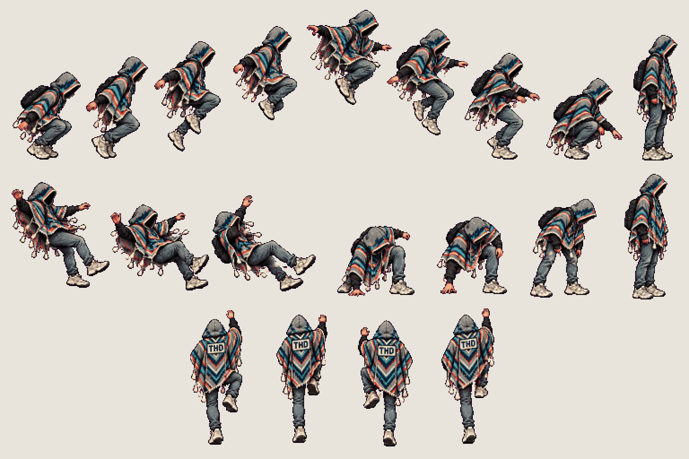
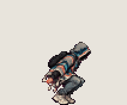
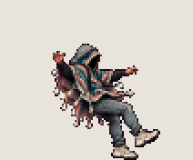
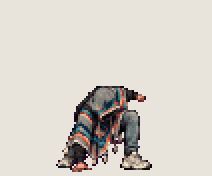
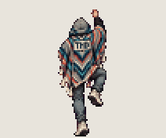

# The student · jump, fall, climb

<!-- nav:start -->
[← The student · death](hero-death.md) · [Sprite boards](README.md) · **7 / 16** · [Chair · side sweep →](chair-side.md)
<!-- nav:end -->

**Review:** ✅ Approved 23 Oct by Alexander. Counts match docs/07; exported to game/public/assets/sprites/ with export_atlas.py. The looping previews below are at twice game size.

## In motion

At twice game size, 12 fps unless the atlas says otherwise: jump, fall, hard-landing, ladder.

   

## Brief

On a flat, solid, pure magenta #FF00FF background (no paper colour, no ground shadows, no dust under the feet), with NO text at all - no titles, no captions, no frame numbers, no labels under the figures: Hero from the first image (keep the THD poncho, the shadow-filled hood and all proportions exactly), facing right, strict side view, identical scale in every frame. 3 rows. Row 1, exactly 9 figures: JUMP - crouch anticipation, take-off, rise, rise higher, apex (the poncho billows up, tassels float), turn over, descend, landing squash, recover to standing. Row 2, exactly 7 figures: FALL loop, 3 frames (poncho flapping upward, arms out for balance), then HARD LANDING, 4 frames (deep impact crouch with one hand on the ground and a puff of dust, push up, straighten, stand). Row 3, exactly 4 figures: CLIMBING A LADDER seen from BEHIND (back to the viewer, the THD crest patch on the poncho's back visible, hood up), hands and feet alternating on invisible rungs in a 4-frame loop; do not draw the ladder itself. Every figure stands on the SAME invisible ground line, even airborne poses: the game moves the body, so never draw a figure higher up. Each row's figures are evenly spaced from left to right with wide clear magenta gaps between neighbours: no tassel, foot, hand or poncho edge touches the next figure, and rows are separated by empty magenta bands. Draw distinct key poses, never blurred in-betweens; neighbouring frames change by small continuous steps so they loop smoothly. Count the figures: each row has EXACTLY the number stated.

## Inputs

- [hero-preview.png](images/hero-preview.png)
- [style-master-preview.png](../direction/images/style-master-preview.png)

Model `gpt-image-2.5-sunburst` · pixel factor 2 · source image `images/hero-air.png` · rebuild: `python scripts/make_boards.py draw hero-air --redo --config art/sprites/boards.json`

<!-- nav:start -->
[← The student · death](hero-death.md) · [Sprite boards](README.md) · **7 / 16** · [Chair · side sweep →](chair-side.md)
<!-- nav:end -->
