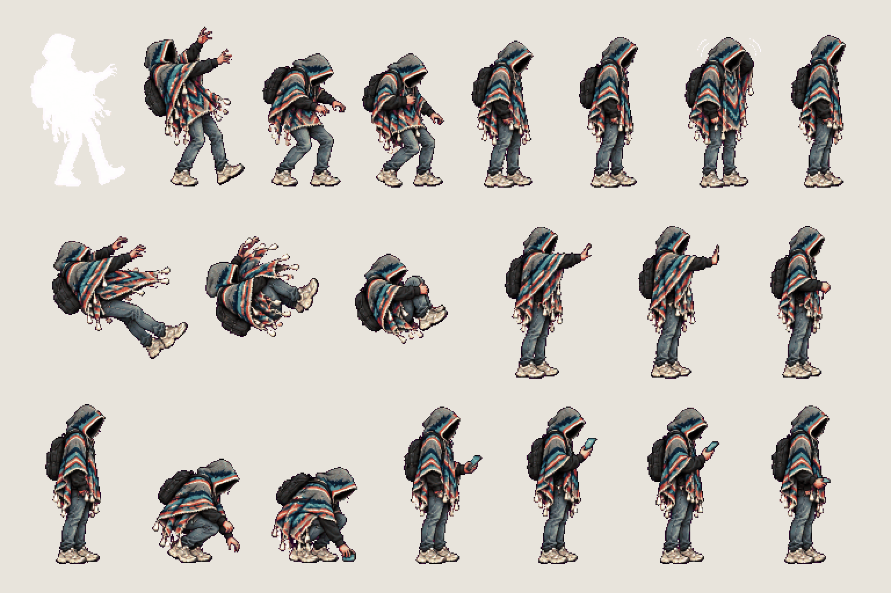
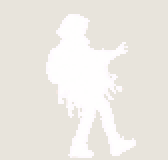
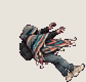
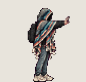
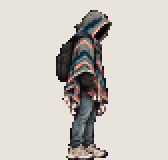
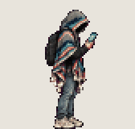

# The student · hurt and interact

<!-- nav:start -->
[← The student · run](hero-run.md) · [Sprite boards](README.md) · **5 / 32** · [The student · death →](hero-death.md)
<!-- nav:end -->

**Review:** ✅ Approved 23 Oct by Alexander. Counts match docs/07; exported to game/public/assets/sprites/ with export_atlas.py. The looping previews below are at twice game size.

## In motion

At twice game size, 12 fps unless the atlas says otherwise: hit, knockback, interact, pick-up, look-at-device.

    

## Brief

On a flat, solid, pure magenta #FF00FF background (no paper colour, no ground shadows, no dust under the feet), with NO text at all - no titles, no captions, no frame numbers, no labels under the figures: Hero from the first image (keep the THD poncho, the shadow-filled hood and all proportions exactly), facing right, strict side view, identical scale in every frame. 3 rows. Row 1, exactly 8 figures: TAKE A HIT, cartoonish and simple - a pure white flash silhouette of the hero, recoil backwards with arms flung up, stagger, wobble, catch balance, straighten, shake it off, back to standing. Row 2, exactly 6 figures: KNOCKBACK, 3 frames (launched backwards, poncho and tassels whipping forward, tumbling, curled up), then INTERACT, 3 frames (reach out and touch something at chest height, hold, pull the hand back). Row 3, exactly 7 figures: PICK UP, 4 frames (crouch, reach to the ground, grab, stand up holding a small item), then LOOK AT THE DEVICE, 3 frames (raise a small brushed-aluminium handheld computer with a glowing blue screen, look down at it, lower it). The THD crest patch is on the poncho's BACK only and is never visible from the side. Every figure stands on the SAME invisible ground line, even airborne poses: the game moves the body, so never draw a figure higher up. Each row's figures are evenly spaced from left to right with wide clear magenta gaps between neighbours: no tassel, foot, hand or poncho edge touches the next figure, and rows are separated by empty magenta bands. Draw distinct key poses, never blurred in-betweens; neighbouring frames change by small continuous steps so they loop smoothly. Count the figures: each row has EXACTLY the number stated.

## Inputs

- [hero-preview.png](images/hero-preview.png)
- [style-master-preview.png](../direction/images/style-master-preview.png)

Model `gpt-image-2.5-sunburst` · pixel factor 2 · source image `images/hero-hurt.png` · rebuild: `python scripts/make_boards.py draw hero-hurt --redo --config art/sprites/boards.json`

<!-- nav:start -->
[← The student · run](hero-run.md) · [Sprite boards](README.md) · **5 / 32** · [The student · death →](hero-death.md)
<!-- nav:end -->
