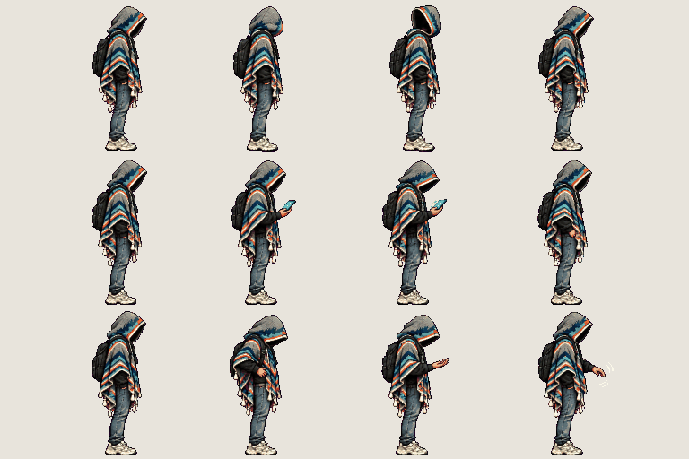
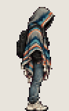
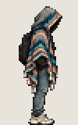
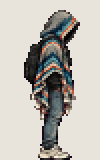

# The student · idle variants

<!-- nav:start -->
[← The student · walk](hero-move.md) · [Sprite boards](README.md) · **3 / 7** · [The student · run →](hero-run.md)
<!-- nav:end -->

**Review:** ✅ Approved 23 Oct by Alexander. Counts match docs/07; exported to game/public/assets/sprites/ with export_atlas.py. The looping previews below are at twice game size.

## In motion

At twice game size, 12 fps unless the atlas says otherwise: look-around, check-tablet, check-wounds.

  

## Brief

On a flat, solid, pure magenta #FF00FF background (no paper colour, no ground shadows, no dust under the feet), with NO text at all - no titles, no captions, no frame numbers, no labels under the figures: Hero from the first image (keep the THD poncho, the shadow-filled hood and all proportions exactly), facing right, strict side view, identical scale in every frame. 3 rows. Row 1, exactly 4 figures: LOOK AROUND - the hood turns slowly back over the shoulder and returns (the inside of the hood stays pure black shadow, no face ever). Row 2, exactly 4 figures: CHECK THE TABLET - lifts a small glowing handheld device from under the poncho, looks down at its screen, lowers it again. Row 3, exactly 4 figures: CHECK WOUNDS - pats the side of the body under the poncho, looks down at the hand, shakes it off. Every figure stands on the SAME invisible ground line, even airborne poses: the game moves the body, so never draw a figure higher up. Each row's figures are evenly spaced from left to right with wide clear magenta gaps between neighbours: no tassel, foot, hand or poncho edge touches the next figure, and rows are separated by empty magenta bands. Draw distinct key poses, never blurred in-betweens; neighbouring frames change by small continuous steps so they loop smoothly. Count the figures: each row has EXACTLY the number stated.

## Inputs

- [hero-preview.png](images/hero-preview.png)
- [style-master-preview.png](../direction/images/style-master-preview.png)

Model `gpt-image-2.5-sunburst` · pixel factor 2 · source image `images/hero-idle.png` · rebuild: `python scripts/make_boards.py draw hero-idle --redo --config art/sprites/boards.json`

<!-- nav:start -->
[← The student · walk](hero-move.md) · [Sprite boards](README.md) · **3 / 7** · [The student · run →](hero-run.md)
<!-- nav:end -->
