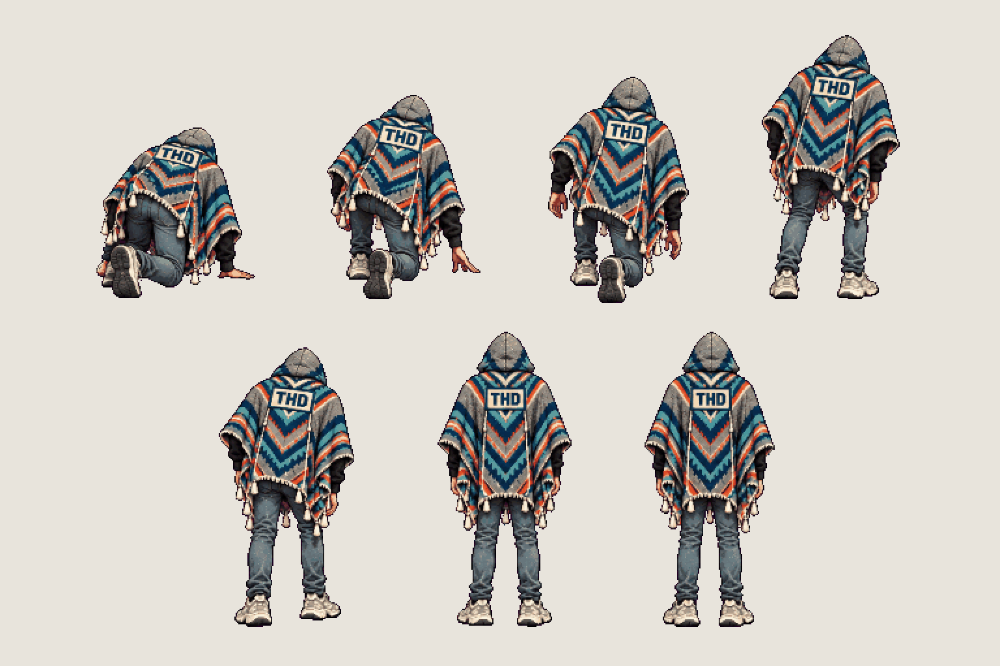
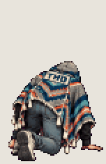
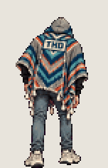

# The student · ladder top and bottom

<!-- nav:start -->
[← The student · jump, fall, climb](hero-air.md) · [Sprite boards](README.md) · **8 / 28** · [Chair · side sweep →](chair-side.md)
<!-- nav:end -->

**Review:** Not reviewed yet.

## In motion

At twice game size, 12 fps unless the atlas says otherwise: ladder-top, ladder-bottom.

 

## Brief

On a flat, solid, pure magenta #FF00FF background (no paper colour, no ground shadows, no dust under the feet), with NO text at all - no titles, no captions, no frame numbers, no labels under the figures: Hero from the first image (keep the THD poncho, the shadow-filled hood and all proportions exactly), EVERY figure seen from BEHIND exactly like the fifth figure of the first image (back to the viewer, the THD crest patch on the poncho's back visible, hood up, no face, no backpack showing), identical scale in every frame. Only the hero: no objects, no furniture, no scenery, no poles or bars anywhere. 2 rows, 7 figures in total. Row 1, exactly 4 figures, GETTING UP FROM THE FLOOR: (1) kneeling on one knee, leaning forward, both palms flat on the floor in front of him at shoulder width; (2) the other foot planted, that knee raised high, both hands pushing on that knee; (3) half risen, back still bent; (4) standing upright, arms at his sides. Row 2, exactly 3 figures, LOWERING THE ARMS: (1) standing on one leg, both arms stretched straight up above the hood with the fists closed, the other knee lifted to hip height; (2) both feet on the floor, elbows bent, hands at shoulder height; (3) standing upright, arms at his sides. Every figure stands on the SAME invisible ground line, even the kneeling pose: the game moves the body, so never draw a figure higher up. Each row's figures are evenly spaced from left to right with wide clear magenta gaps between neighbours: no tassel, foot, hand or poncho edge touches the next figure, and the two rows are separated by an empty magenta band. Draw distinct key poses, never blurred in-betweens. Count the figures: row 1 has EXACTLY 4, row 2 EXACTLY 3.

## Inputs

- [hero-preview.png](images/hero-preview.png)
- [style-master-preview.png](../direction/images/style-master-preview.png)

Model `gpt-image-2.5-sunburst` · pixel factor 2 · source image `images/hero-ladder.png` · rebuild: `python scripts/make_boards.py draw hero-ladder --redo --config art/sprites/boards.json`

<!-- nav:start -->
[← The student · jump, fall, climb](hero-air.md) · [Sprite boards](README.md) · **8 / 28** · [Chair · side sweep →](chair-side.md)
<!-- nav:end -->
