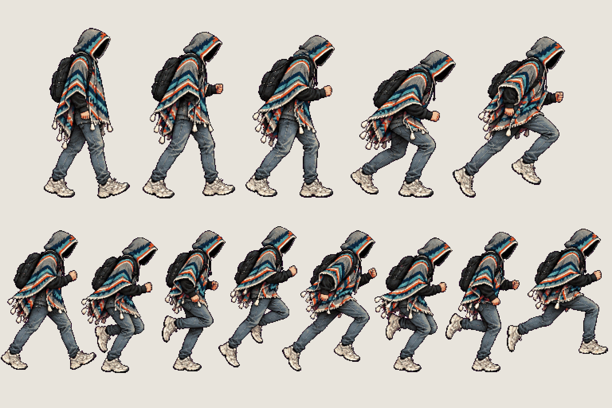
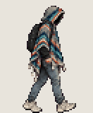
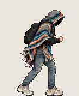
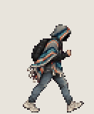

# The student · run

<!-- nav:start -->
[← The student · idle variants](hero-idle.md) · [Sprite boards](README.md) · **4 / 32** · [The student · hurt and interact →](hero-hurt.md)
<!-- nav:end -->

**Review:** ✅ Approved 23 Oct by Alexander. Counts match docs/07; exported to game/public/assets/sprites/ with export_atlas.py. The looping previews below are at twice game size.

## In motion

At twice game size, 12 fps unless the atlas says otherwise: walk-run, run-start, run.

  

## Brief

On a flat, solid, pure magenta #FF00FF background (no paper colour, no ground shadows, no dust under the feet), with NO text at all - no titles, no captions, no frame numbers, no labels under the figures: Hero from the first image (keep the THD poncho, the shadow-filled hood and all proportions exactly), facing right, strict side view, identical scale in every frame. 2 rows. Row 1, exactly 5 figures: WALK TO RUN, 2 frames (lean forward, arms start to pump), then RUN START from standing, 3 frames (crouch, push off, first long stride). Row 2, exactly 8 figures: RUN cycle in key poses - contact, down, passing, up for each leg, with long strides and one foot clearly off the ground; leaning forward, poncho and tassels streaming back, backpack bouncing. The THD crest patch is on the poncho's BACK only and is never visible from the side. Every figure stands on the SAME invisible ground line, even airborne poses: the game moves the body, so never draw a figure higher up. Each row's figures are evenly spaced from left to right with wide clear magenta gaps between neighbours: no tassel, foot, hand or poncho edge touches the next figure, and rows are separated by empty magenta bands. Draw distinct key poses, never blurred in-betweens; neighbouring frames change by small continuous steps so they loop smoothly. Count the figures: each row has EXACTLY the number stated.

## Inputs

- [hero-preview.png](images/hero-preview.png)
- [style-master-preview.png](../direction/images/style-master-preview.png)

Model `gpt-image-2.5-sunburst` · pixel factor 2 · source image `images/hero-run.png` · rebuild: `python scripts/make_boards.py draw hero-run --redo --config art/sprites/boards.json`

<!-- nav:start -->
[← The student · idle variants](hero-idle.md) · [Sprite boards](README.md) · **4 / 32** · [The student · hurt and interact →](hero-hurt.md)
<!-- nav:end -->
