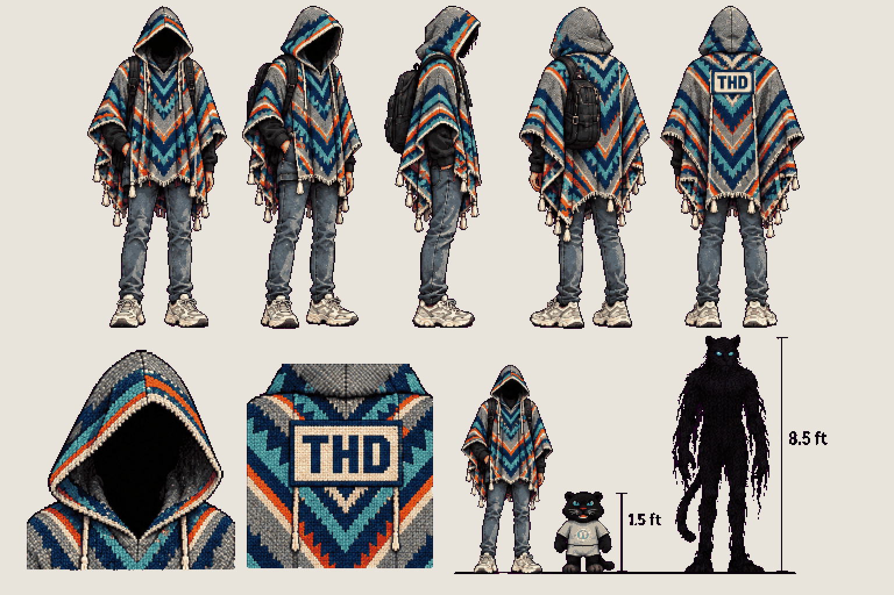

# The student · hero design

<!-- nav:start -->
[← Sprite boards](README.md) · [Sprite boards](README.md) · **1 / 1** · [Sprite boards →](README.md)
<!-- nav:end -->

**Review:** ✅ Approved 23 Oct. Adult 6 ft, face never visible, THD poncho in grey / THD blue / teal with colourful accents, THD crest on the back, scale lineup with Dexter (1.5 ft) and his final form (8.5 ft). Fourth iteration: chibi proportions, a hoodie and a visible face were rejected along the way.

## Brief

Keep the body, height (6 ft adult), proportions, pose, backpack, grey slim jeans and chunky white sneakers of the hero in the first image, and the poncho's CUT, tassel fringe and geometric zig-zag weave from the second image, but RECOLOUR and redesign the poncho as the university's own THD poncho: heather-grey base, deep THD blue and teal zig-zag bands, with a few thin colourful accent stripes (orange, cream, a little red). The poncho has its OWN deep hood, always up. The face is NEVER visible: inside the hood is only solid dark shadow - no eyes, no glasses, no hair, no chin. Gender must be impossible to tell: no visible hair, no visible face, loose silhouette. No hoodie, no scarf. Clean pixel-art CHARACTER SHEET on a flat magenta background, no scenery and no panels. Row 1, full-body turnaround, 5 figures at identical scale: front, three-quarter front, side facing right, three-quarter back, BACK - on the back the poncho has a bold woven THD crest patch in cream and blue with the letters THD clearly readable. Row 2: a close-up of the hood (pure shadow inside), a close-up of the THD back patch, then a scale lineup on one ground line: the hero, a 1.5 ft black panther plush mascot in a grey T-shirt at knee height (third image), and an 8.5 ft tall shadowy panther-humanoid silhouette with glowing blue eyes.

## Inputs

- `hero-design` (earlier draft, outside Git)
- `20261022_164630.jpg` (GameJam_References-2, outside Git)
- `thd-sticker-deggster-2_1280x1280.png` (GameJam_Merch, outside Git)

Model `gpt-image-2.5-sunburst` · pixel factor 2 · source image `images/hero.png` · rebuild: `python scripts/make_boards.py draw --config art/sprites/boards.json --redo hero`

<!-- nav:start -->
[← Sprite boards](README.md) · [Sprite boards](README.md) · **1 / 1** · [Sprite boards →](README.md)
<!-- nav:end -->
