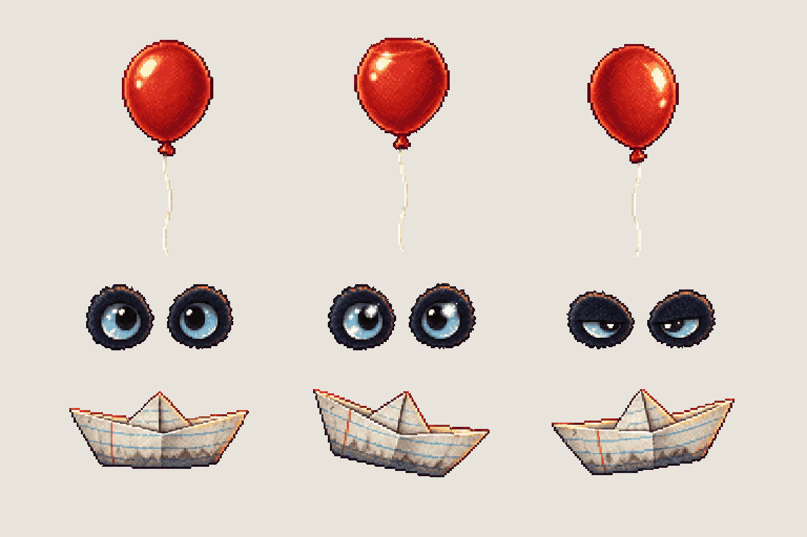
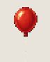
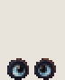
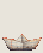

# Props · the storm drain's IT details

<!-- nav:start -->
[← Menu · the Hidden Garden at first light](menu-key.md) · [Sprite boards](README.md) · **28 / 28** · [Sprite boards →](README.md)
<!-- nav:end -->

**Review:** 🟨 Awaiting Alexander's review (25 Oct). First draw: three distinct props in the food sheet's look. The board's 1 px balloon string broke up when crushed, so the game draws the string; the eyes are two pieces per frame ("parts": 2). Sizes per animation: balloon about 18 px, eyes 7 px, boat 9 px against the 76 px hero. In the drain: previews/it-props-in-drain.png.

## In motion

At twice game size, 12 fps unless the atlas says otherwise: balloon, eyes, boat.

  

## Brief

On a flat, solid, pure magenta #FF00FF background (no paper colour, no ground shadows, no dust under the objects), with NO text at all - no titles, no captions, no frame numbers, no labels, no readable words or logos: Image 1 is an approved prop sheet from this game: draw this sheet in exactly that pixel-art look - small detailed props in rows on magenta, the same pixel grain and the same soft warm lantern rim light. Prop sprite sheet of three small story details found in a campus storm drain (secret horror: friendly at first glance, wrong on a second look). 3 rows. Row 1, exactly 3 frames: ONE RED BALLOON, an ordinary glossy latex party balloon, deep red with a white highlight, tied knot at the bottom and a thin white string hanging straight down about one and a half times the balloon's height - frame 1 at rest, frame 2 pressed up a little (top slightly flattened as if against a ceiling), frame 3 turned slightly so the highlight moves. Row 2, exactly 3 frames: TWO EYES IN THE DARK - only the pair of glossy round ice-blue plush eyes of the black panther plush from image 2, side by side, with a thin ring of very dark navy fabric around each eye (nothing else of the head): frame 1 open and calm, frame 2 the same with a bright white glint, frame 3 narrowed to half - too glossy, watching. Row 3, exactly 3 frames: ONE SMALL PAPER BOAT folded from a sheet of lined notebook paper (lines only, no writing), slightly soggy and grey at the waterline, side view - frame 1 level, frame 2 tipped a little left, frame 3 tipped a little right, rocking. Sizes against each other: the balloon (without its string) is about twice as tall as the paper boat; the pair of eyes is about as wide as the boat. Every frame of a row stands on the SAME invisible ground line at the SAME scale. Each row's frames are evenly spaced from left to right with wide clear magenta gaps between neighbours, and rows are separated by empty magenta bands. Draw distinct key poses, never blurred in-betweens. Count the frames: each row has EXACTLY 3. No people, no scenery, no pipe, no water.

## Inputs

- [mensa-food-preview.png](images/mensa-food-preview.png)
- [dexter-preview.png](images/dexter-preview.png)
- [style-master-preview.png](../direction/images/style-master-preview.png)

Model `gpt-image-2.5-sunburst` · pixel factor 2 · source image `images/it-props.png` · rebuild: `python scripts/make_boards.py draw it-props --redo --config art/sprites/boards.json`

<!-- nav:start -->
[← Menu · the Hidden Garden at first light](menu-key.md) · [Sprite boards](README.md) · **28 / 28** · [Sprite boards →](README.md)
<!-- nav:end -->
