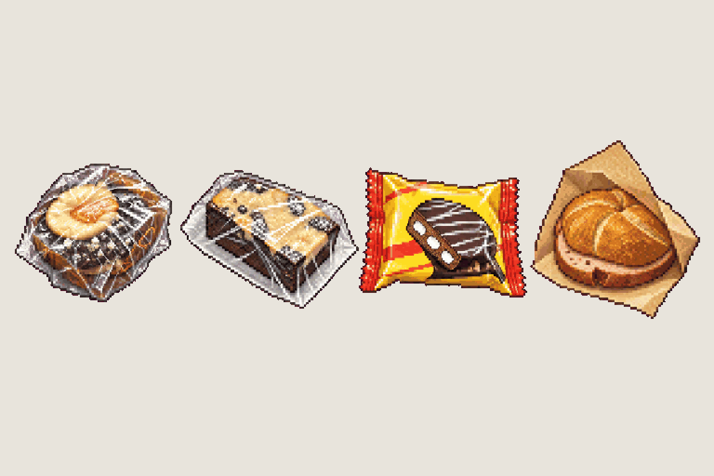
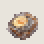
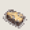
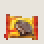
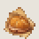

# Mensa · food pickups

<!-- nav:start -->
[← Item · pocket computer](pocket-computer.md) · [Sprite boards](README.md) · **18 / 21** · [Prop · coffee machine (save point) →](coffee-machine.md)
<!-- nav:end -->

**Review:** 🟡 Drawn 24 Oct, awaiting Alexander's review (#52). Third draw: the first two copied only the muffin; anchoring on the approved coffee-machine sheet gave four distinct items. One frame each (the model ignored the sparkle frames; the game adds the sparkle). Muffin 16 × 14, cake 18 × 14, wafer 17 × 13, Leberkäse roll 18 × 18 px – around the documented 16 px. Not exported until approved.

## In motion

At twice game size, 12 fps unless the atlas says otherwise: muffin, cake, wafer, leberkaese.

   

## Brief

On a flat, solid, pure magenta #FF00FF background (no paper colour, no ground shadows, no dust under the objects), with NO text at all - no titles, no captions, no frame numbers, no labels, no readable brand names: Image 1 is an approved sprite sheet from this game: draw this sheet in exactly that pixel-art look and at that sheet layout - small sprites in a row on magenta. Pickup sprite sheet of FOUR DIFFERENT cafeteria foods, one per FOOD photo (images 2 to 5), in that order - never repeat an item: (1) the chocolate MUFFIN from image 2, squashed in wrinkled, glare-streaked cling film; (2) the marbled chocolate-vanilla CAKE SLICE from image 3, a flat rectangular slab in crumpled cling film on a white paper; (3) the chocolate WAFER bar from image 4 in its flat yellow-red foil wrapper (no readable brand); (4) the LEBERKAESE ROLL from image 5, a round crusty kaiser roll with a thick pink meat slice sticking out, half in a torn brown paper bag. Copy each EXACTLY as it really looks, not an idealized product shot. All four at the SAME pixel scale, about the same size as each other, small pickups resting on the ground line. 1 row, exactly 4 frames: muffin, cake slice, wafer, Leberkaese roll (the game adds the pickup sparkle). The four foods must look clearly different from each other in shape and colour. Every frame stands on the SAME invisible ground line at the SAME scale. Frames are evenly spaced from left to right with wide clear magenta gaps between neighbours. Count the frames: the row has EXACTLY 4. No people, no scenery.

## Inputs

- [coffee-machine-preview.png](images/coffee-machine-preview.png)
- `20261023_125038.jpg` (GameJam_References-2, outside Git)
- `20261023_125049.jpg` (GameJam_References-2, outside Git)
- `20261023_125100.jpg` (GameJam_References-2, outside Git)
- `20261023_125259.jpg` (GameJam_References-2, outside Git)
- [style-master-preview.png](../direction/images/style-master-preview.png)

Model `gpt-image-2.5-sunburst` · pixel factor 2 · source image `images/mensa-food.png` · rebuild: `python scripts/make_boards.py draw mensa-food --redo --config art/sprites/boards.json`

<!-- nav:start -->
[← Item · pocket computer](pocket-computer.md) · [Sprite boards](README.md) · **18 / 21** · [Prop · coffee machine (save point) →](coffee-machine.md)
<!-- nav:end -->
