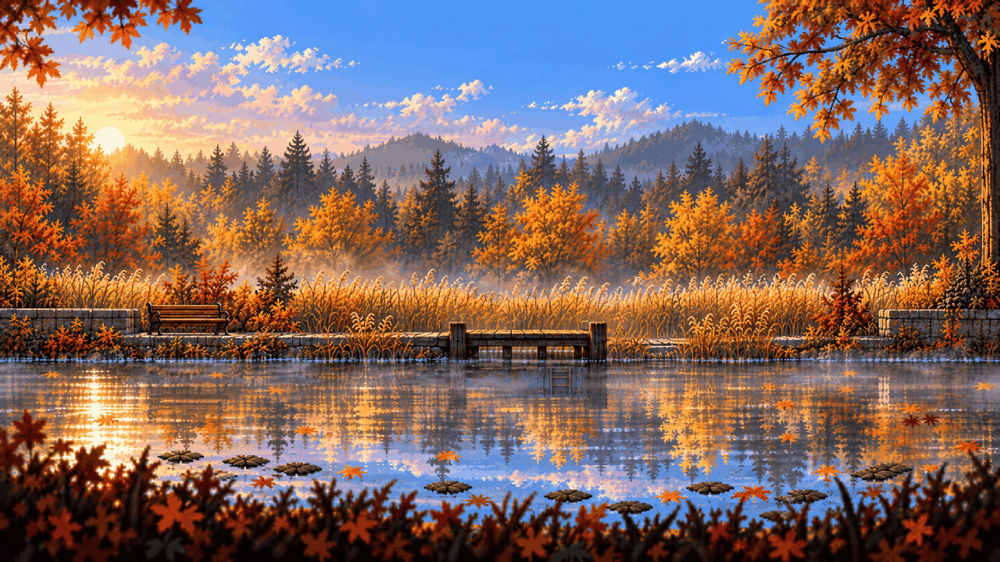

# Menu · the Hidden Garden at first light

<!-- nav:start -->
[← Dexter · prologue additions](dexter-prologue.md) · [Sprite boards](README.md) · **27 / 32** · [Props · the storm drain's IT details →](it-props.md)
<!-- nav:end -->

**Review:** 🟡 Drawn 24 Oct for the prologue menu (workstream 5); exported to game/public/assets/ui/menu-key.png with scripts/export_key_art.py, awaiting Alexander's review.

## Brief

Key art for the game's title menu, a full 16:9 picture in exactly the hi-bit pixel-art look of the first image (the style master) - the magenta and sprite-sheet rules do NOT apply to this one image: it is a full scene. ABSOLUTELY NO TEXT, no logo, no title, no letters, no UI, no characters, no people, no animals. The scene: the Hidden Garden pond from images 2 and 3 at FIRST LIGHT, early morning - the low sun just rising behind the far conifer forest on the left, a pale gold-and-rose sky turning blue above, thin mist lying over the still pond. Strict side view like a game screen, everything parallel to the screen: the far hills and dark conifers, the band of autumn trees in yellow, orange and russet, the tall golden reed bed, the low stone wall and the small timber jetty at the water's edge, the empty park bench on the left. The pond fills the lower third and mirrors everything like a Kingdom Two Crowns reflection, with lily pads and a few floating maple leaves, and a dark blurred foreground of autumn leaves and grass along the bottom edge. Leave calm, simple sky in the upper middle (the game puts its title there). Cozy and beautiful, and only on a second look a little too still: in the reflection right below the jetty, one small patch reflects something that is not there - a faint rusty blue-green girder - very subtle.

## Inputs

- [style-master-preview.png](../direction/images/style-master-preview.png)
- [hg-4-0.png](../stages/hidden-garden/images/hg-4-0.png)
- [hg-0-0.png](../stages/hidden-garden/images/hg-0-0.png)
- [hidden-garden-preview.png](../direction/images/hidden-garden-preview.png), cropped to `0,0,1536,560`

Model `gpt-image-2.5-sunburst` · pixel factor 2 · source image `images/menu-key.png` · rebuild: `python scripts/make_boards.py draw menu-key --redo --config art/sprites/boards.json`

<!-- nav:start -->
[← Dexter · prologue additions](dexter-prologue.md) · [Sprite boards](README.md) · **27 / 32** · [Props · the storm drain's IT details →](it-props.md)
<!-- nav:end -->
