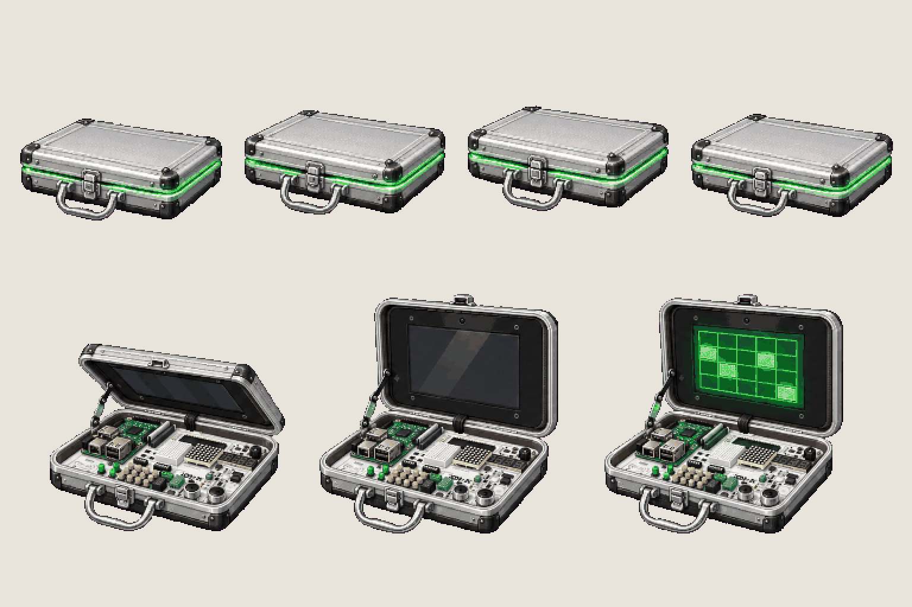
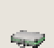
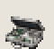

# Item · pocket computer

<!-- nav:start -->
[← Boss · Jenny, stunned and debris](boss-jenny-2.md) · [Sprite boards](README.md) · **17 / 26** · [Mensa · food pickups →](mensa-food.md)
<!-- nav:end -->

**Review:** ✅ Approved 24 Oct by Alexander (#154); exported to game/public/assets/sprites/ with export_atlas.py. Closed case 19 × 10 px (≈ 45 cm at the hero's 76 px = 183 cm): the photographed suitcase, shrunk to carry; open with the green screen 22 px tall. The map screens are the approved UI atlas (#127), so this board has no screen mock-ups.

## In motion

At twice game size, 12 fps unless the atlas says otherwise: bob, open.

 

## Brief

On a flat, solid, pure magenta #FF00FF background (no paper colour, no ground shadows, no dust under the objects), with NO text at all - no titles, no captions, no frame numbers, no labels, no readable brand names: Key item sprite sheet: the aluminium experiment suitcase from the photos, copied exactly - a silver hard case with rounded corners and a carry handle, a black screen in the lid, a white circuit tray inside with a green circuit board, rows of yellow and green buttons, plug sockets - shrunk into a hand-held 'pocket computer'. Side-on three-quarter view. 2 rows. Row 1, exactly 4 frames: the case CLOSED, lying flat, with a soft green glow at its seam, bobbing up and down a little (frames 1-4 of a gentle float). Row 2, exactly 3 frames: the case OPENING - the lid lifts halfway, the lid fully open with the dark screen, the screen lit up green with a simple block grid on it (no words). Every frame stands on the SAME invisible ground line at the SAME scale. Each row's frames are evenly spaced from left to right with wide clear magenta gaps between neighbours, and rows are separated by empty magenta bands. Draw distinct key poses, never blurred in-betweens. Count the frames: each row has EXACTLY the number stated. No people, no scenery.

## Inputs

- `20261023_125955.jpg` (GameJam_References-2, outside Git)
- `20261023_130000.jpg` (GameJam_References-2, outside Git)
- `20261023_130003.jpg` (GameJam_References-2, outside Git)
- [style-master-preview.png](../direction/images/style-master-preview.png)

Model `gpt-image-2.5-sunburst` · pixel factor 2 · source image `images/pocket-computer.png` · rebuild: `python scripts/make_boards.py draw pocket-computer --redo --config art/sprites/boards.json`

<!-- nav:start -->
[← Boss · Jenny, stunned and debris](boss-jenny-2.md) · [Sprite boards](README.md) · **17 / 26** · [Mensa · food pickups →](mensa-food.md)
<!-- nav:end -->
