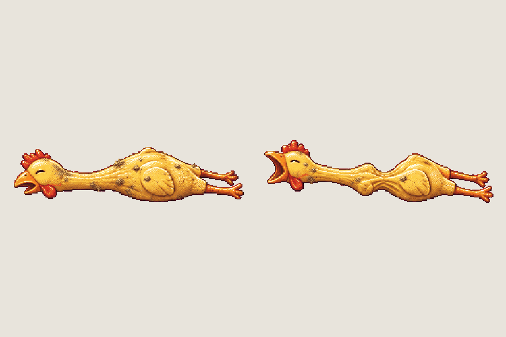

# Secret · the rubber chicken

<!-- nav:start -->
[← Props · the storm drain's IT details](it-props.md) · [Sprite boards](README.md) · **29 / 31** · [Prop · Jenny's arena platforms →](arena-platform.md)
<!-- nav:end -->

**Review:** 🟨 Awaiting Alexander's review (25 Oct). Playtest T2 (Lex): the rubber chicken must be in the game. First draw, two frames (resting, squeezed mid-squeak); about 34 x 9 px in the game, a little bigger than a real one so it reads next to the 76 px hero.

## Brief

On a flat, solid, pure magenta #FF00FF background (no paper colour, no ground shadows, no dust under the objects), with NO text at all - no titles, no captions, no frame numbers, no labels, no readable words or logos: Image 1 is an approved prop sheet from this game: draw this sheet in exactly that pixel-art look - small detailed props on magenta, the same pixel grain and the same soft warm rim light. Prop sprite sheet of ONE classic squeaky RUBBER CHICKEN toy - the long-necked plucked yellow rubber chicken with a red comb, an open orange beak, tiny closed eyes, skinny dangling legs - lying on its side on the ground, side view, slightly worn and dusty as if it had been lost in a garden for a while. 1 row, exactly 2 frames: frame 1 resting, frame 2 the same chicken squeezed in the middle, its body pinched thin and its beak wide open mid-squeak, neck stretched. Both frames at the SAME pixel scale, standing on the SAME invisible ground line, evenly spaced with a wide clear magenta gap between them. Draw distinct key poses. Count the frames: the row has EXACTLY 2. No people, no hands, no scenery.

## Inputs

- [mensa-food-preview.png](images/mensa-food-preview.png)
- [style-master-preview.png](../direction/images/style-master-preview.png)

Model `gpt-image-2.5-sunburst` · pixel factor 2 · source image `images/rubber-chicken.png` · rebuild: `python scripts/make_boards.py draw rubber-chicken --redo --config art/sprites/boards.json`

<!-- nav:start -->
[← Props · the storm drain's IT details](it-props.md) · [Sprite boards](README.md) · **29 / 31** · [Prop · Jenny's arena platforms →](arena-platform.md)
<!-- nav:end -->
