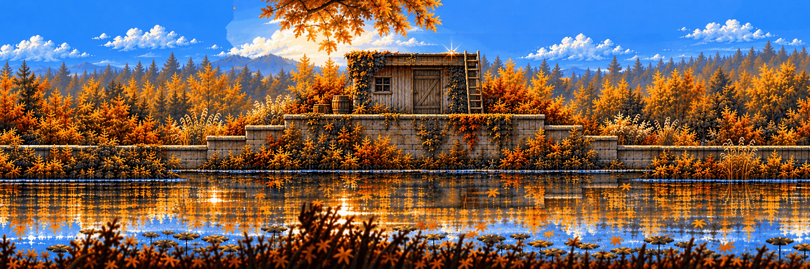
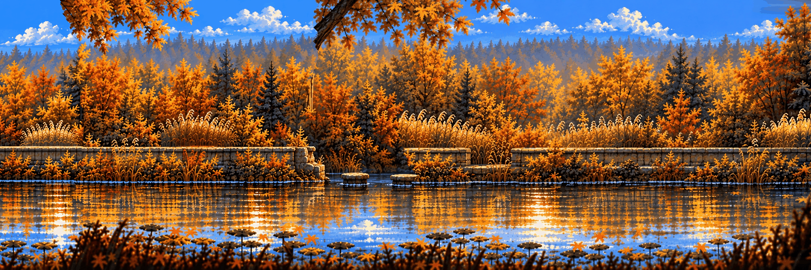
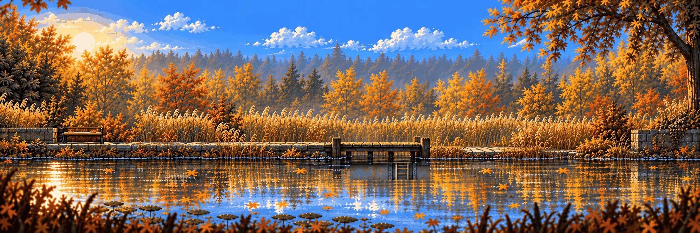

# Hidden Garden – stage chunks

The prologue, drawn from the approved [Hidden Garden concept](../../locations/hidden-garden-clean.md) as a flat side elevation: **five chunks, 10 800 px**, about 70 s of walking plus Dexter's waits and two detours ([docs/04 – Hidden Garden, the prologue level](../../../docs/04-WORLD-AND-LEVELS.md#hidden-garden--the-prologue-level), #50). `hg-4-0` is the approved pond chunk (the jetty where Dexter points, the wrong reflection). The four before it were grown leftwards from it with [grow_stage.py](../../../scripts/grow_stage.py) – scenery first, one masked repaint per route feature, the seams between new chunks repainted (docs/09): `hg-0-0` the gate (Dexter's bench, a birch log), `hg-1-0` the hill (an oak on the crest, a hollow behind the grass), `hg-2-0` the terraces (a shed with a ladder to its roof), `hg-3-0` the boardwalk (a gap with stepping stones). Clean only.

**Layers** (#142, docs/15 P2/P3): each chunk's depth key comes from the model, its masks from the key ([depth_layers.py](../../../scripts/depth_layers.py), [layers.json](layers.json)). Back to front, like a hot dog: sky 0.1, far forest 0.25, mid trees 0.6 (region plates, painted whole under everything nearer and quilted), then at scroll 1 the rear (reeds, walls, the shed), the water, the trail, and the **near strip** – grass painted along each trail's walk line, z 6, drawn over the hero's feet – and last the blurred foreground leaves at 1.2. Every scroll-1 layer is filled behind the foreground and the strip ([fills/](fills/)), and the canopy pieces that hung from nothing on the grown chunks are painted out; the oak on the hill is a stump now. [docs/09](../../../docs/09-ART-PIPELINE.md#every-plate-complete--the-hot-dog-docs15-p2-p3) has the steps. **Collision**: walk lines traced from each key's play band (`depth_layers.py collision`), spawns, Dexter's waypoints and triggers placed by hand; overlays in [collision/](collision/).

The whole walk: [prologue.png](images/prologue.png) · the parallax at five camera positions: [parallax.png](images/parallax.png) (`python scripts/compare.py parallax art/stages/hidden-garden --at 0 2000 4000 6000 8000`).

| | |
| --- | --- |
|  **[Hidden Garden · the gate](hg-0-0.md)** |  **[Hidden Garden · the hill](hg-1-0.md)** |
|  **[Hidden Garden · the terraces](hg-2-0.md)** |  **[Hidden Garden · the boardwalk](hg-3-0.md)** |
|  **[Hidden Garden · the bench and the pond](hg-4-0.md)** |  |
