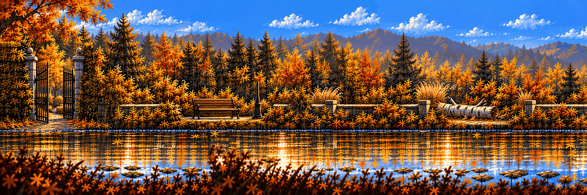

# Hidden Garden · the bench and the pond

**Review:** 🟡 Drawn 24 Oct, waiting for Alexander's Design review. The figures of the concept are removed; the bench and the wrong reflection were painted in afterwards with masked edits that change only their own rectangles.

## Brief

Wide side-scrolling stage chunk at 3:1, drawn as an architect's elevation with everything parallel to the screen (no vanishing point, no receding paths): the Hidden Garden pond from the first image, redrawn as a flat side view. Keep its look exactly - late-afternoon autumn light, golden reeds, orange and yellow trees, the misty pine forest behind, a blue sky with small clouds, the big tree in the upper right. Ground: from the left edge a stone-slab path at ground level, its top at about two thirds of the height, runs right onto a timber jetty over the pond; the jetty ends a little right of the middle with two posts - the spot where someone would stand and look down into the water. The calm pond fills the bottom across the whole width and reflects the reeds and trees. ONE patch of the reflection just below the end of the jetty is WRONG: it shows a rusty blue-green riveted girder structure that does not exist above the water. On the right, reeds and a low mossy stone wall close the scene. Along the very bottom edge, a few dark out-of-focus reed silhouettes in the foreground. Remove the two figures of the first image: NO people, NO animals, NO plush toy, nothing standing on the jetty.

## Inputs

- [hidden-garden-clean.png](../../locations/images/hidden-garden-clean.png)
- [style-master-preview.png](../../direction/images/style-master-preview.png)

Model `gpt-image-2.5-sunburst` · pixel factor 1 · source image `images/hg-0-0.png` · rebuild: `python scripts/make_boards.py draw hg-0-0 --redo --config art/stages/hidden-garden/boards.json`
