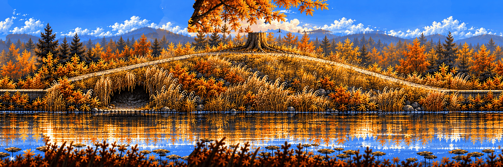

# Hidden Garden · the hill

**Review:** To review (24 Oct, #50): grown leftwards from the pond with grow_stage.py; route feature repainted; seams joined.

## Brief

A gravel path at y=441 at both edges rolls over a smooth grassy hill: it starts rising at x=320, reaches the round crest at x=1080, y=331, and comes back down to y=441 at x=1840 - gentle slopes, no steps. An old oak with a wide autumn crown stands on the crest (trunk at x=1040-1120). Under the hill's left flank, behind a curtain of tall golden grass, a small dark hollow opens below the path: its floor at y=521 from x=440 to x=700, its roof the hill itself; the grass curtain hangs from the path's edge. Late-afternoon autumn light from the left, golden reeds, orange and yellow trees, a hazy blue conifer line far behind, warm stone and weathered timber, as in the pond chunk next to it. The walkable surface is clearly readable: a lit top edge, darker below.

## Inputs

- [hidden-garden-clean.png](../../locations/images/hidden-garden-clean.png)
- [style-master-preview.png](../../direction/images/style-master-preview.png)

Model `gpt-image-2.5-sunburst` · pixel factor 1 · source image `images/hg-1-0.png` · rebuild: `python scripts/make_boards.py draw hg-1-0 --redo --config art/stages/hidden-garden/boards.json`
